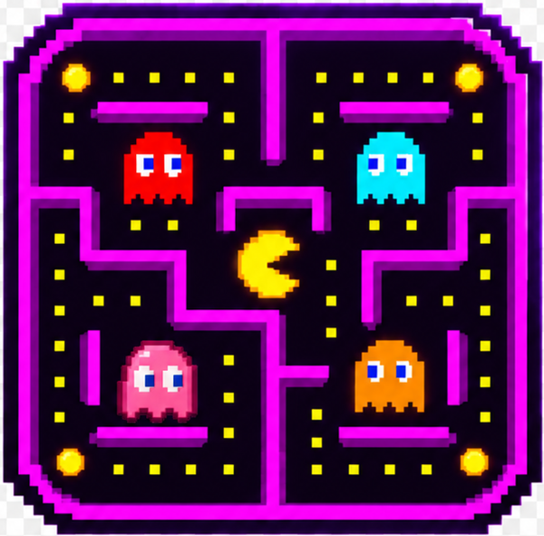

*This project has been created as part of the 42 curriculum by machaouk, hfegrach, nel-khad, ynadime, oelmanso.*

<div align="center">



# PACOVA

**ft_transcendence — a multiplayer Pac-Man web game**

</div>

## Table of Contents

- [Description](#description)
- [Instructions](#instructions)
- [Team Information](#team-information)
- [Project Management](#project-management)
- [Technical Stack](#technical-stack)
- [Database Schema](#database-schema)
- [Features List](#features-list)
- [Modules](#modules)
- [Individual Contributions](#individual-contributions)
- [Resources](#resources)

## Description

**PACOVA** is a real-time multiplayer web game based on the original **Pac-Man**. It is a full web application (frontend, backend, database) built as a set of microservices, with accounts, friends, chat, notifications, statistics and a leaderboard around the game.

**Game rules:** the original Pac-Man rules apply — eat all the pellets, avoid the ghosts, eat a power pellet to make the ghosts vulnerable, 3 lives, one timer. In **remote mode there are two Pac-Mans** in the same maze, played from two different computers.

**Key features**

- Sign up / login (email + password), **42 OAuth**, **2FA**
- Game modes: local, **vs. AI bot** (3 levels), **online 1v1** with matchmaking and 3 mazes
- Real-time chat, friends with online status, notifications
- Profiles, avatars, achievements, match history, leaderboard
- English / French / Arabic, custom design system, responsive UI
- Microservices behind an API gateway, started with one command

> How the app works (diagrams, flows, one page per part): see [`docs/`](docs/README.md).

## Instructions

**Prerequisites:** Docker Engine + Docker Compose v2, Google Chrome (latest). Make is optional. Node.js is not needed on the host.

```bash
git clone git@github.com:HanFeg-42/ft_transcendence.git
cd ft_transcendence
cp .env.example .env      # then fill in the values (see below)
docker compose up --build # or: make
```

Open **https://localhost:443** (self-signed certificate: accept the browser warning once).

**`.env` variables**

| Variable | Meaning |
|---|---|
| `POSTGRES_USER`, `POSTGRES_PASSWORD`, `POSTGRES_DB` | PostgreSQL credentials |
| `AUTH_/USER_/CHAT_/GAME_DATABASE_URL` | One connection string per service |
| `JWT_SECRET`, `REFRESH_TOKEN_SECRET`, `TWO_FACTOR_CHALLENGE_SECRET` | Token secrets (`openssl rand -hex 32`) |
| `FORTYTWO_CLIENT_ID`, `FORTYTWO_CLIENT_SECRET` | 42 OAuth app credentials |
| `FORTYTWO_CALLBACK_URL`, `FRONTEND_URL` | `https://localhost:443/api/auth/42/callback` and `https://localhost:443` |

Databases are created by `postgres-db/init.sql` and Prisma migrations run automatically at container start.

**Make targets:** `make` (build + start), `make down`, `make logs`, `make status`, `make migrate`, `make clean` (also wipes volumes), `make re`.

## Team Information

| Login | Role(s) | Responsibilities |
|---|---|---|
| `hfegrach` | Product Owner, Project Manager, Developer | Owns the backlog, plans sprints, leads meetings |
| `machaouk` | Project Manager, Tech Lead / Architect, Developer | Microservices and gateway architecture, task planning |
| `nel-khad` | Project Manager, Developer | UI/UX and design system, task planning |
| `ynadime` | Developer | Game backend and remote multiplayer |
| `oelmanso` | Developer | Settings and friends |


Code review of critical changes was done by the whole team through Pull Requests.

## Project Management

- **Organisation:** 1-week Scrum sprints (planning, daily stand-up, review/demo, retrospective). Details in [`docs/architecture/team-workflow.md`](docs/architecture/team-workflow.md).
- **Task planning:** `hfegrach` created the backlog (task founder). Every other member worked on their own tasks or edited / split the backlog cards.
- **Tools:** Trello (backlog and sprint board), GitHub (PRs, code review, protected `main` and `dev`), Figma (design).
- **Communication:** Discord (announcements, meeting schedule, pair-programming channels).
- **Git rules:** feature branches (`feat/`, `fix/`, `test/`), PR + 1 approval, Conventional Commits.

## Technical Stack

| Layer | Technology |
|---|---|
| Frontend | React 19 + TypeScript, Vite, React Router, Tailwind CSS 4, i18next |
| Backend | Node.js + Express (TypeScript), `ws` for WebSockets |
| API Gateway | Express + `http-proxy-middleware` + `express-rate-limit` |
| Database | PostgreSQL 17, accessed with Prisma 7 |
| Security | bcrypt, JWT (access + refresh), TOTP 2FA (`otplib`), NGINX TLS |
| Infra | Docker Compose, NGINX |

**Justifications**

- **PostgreSQL:** relational data with clear relations (users, friendships, matches).
- **Microservices:** each service has one responsibility and its own database, so we could work in parallel without conflicts.
- **Express + React:** one language (TypeScript) across the stack, shared WebSocket types in `shared/types`.
- **Server-authoritative game:** the server runs the game loop; clients only send directions.

## Database Schema

One PostgreSQL server, **one database per service**; services reference users by `userId` (no cross-database foreign keys). Full ER diagram: [`docs/architecture/database.md`](docs/architecture/database.md).

| Database | Tables (key fields) | Relations |
|---|---|---|
| `auth_db` | `User` (id, username, email, passwordHash, fortyTwoId, twoFactorEnabled, twoFactorSecret), `TwoFactorRecoveryCode` (userId, codeHash, usedAt) | User 1—N RecoveryCode |
| `user_db` | `Profile` (userId, displayName, bio, avatarUrl, statusText), `Achievement` (id, title, description, image), `UserAchievement` (userId, achievementId, unlocked, progress) | Profile 1—N UserAchievement N—1 Achievement |
| `chat_db` | `Message` (senderId, receiverId, content, kind, meta, readAt), `BlockedUser` (blockerId, blockedId), `FriendRequest` (requesterId, addresseeId, status), `Friendship` (userLowId, userHighId), `Notification` (userId, type, payload, isRead) | Unique pairs on blocks, requests and friendships |
| `game_db` | `Match` (id, mode, status, mazeSeed, timeLimitSeconds, winnerUserId, startedAt, endedAt), `MatchParticipant` (matchId, userId, slot, result, score, pelletsEaten, ghostsEaten, livesRemaining) | Match 1—N MatchParticipant |

## Features List

| Feature | Description | Who |
|---|---|---|
| Sign up / login | Email + password, validated on frontend and backend, bcrypt-hashed, JWT + refresh cookie | `hfegrach` |
| 42 OAuth | "Continue with 42" login | `hfegrach`, `nel-khad` |
| 2FA | TOTP with QR code and recovery codes | `hfegrach` |
| Login / sign-up pages | UI of the auth pages | `nel-khad` |
| Profile | Public/own profile, avatar, rank, achievements, match history | `nel-khad` |
| Settings | Edit profile, avatar upload (default avatar), security, language | `oelmanso` |
| Friends | Requests, accept/decline/remove, list with online status | `oelmanso` |
| Chat | Real-time private chat, history, block, typing, read receipts, game invites, profile access | `machaouk` |
| Notifications | Real-time + persistent, unread counter | `hfegrach` |
| Local game | Local play on one device | `ynadime` |
| Play vs. bot | Pac-Man bot, 3 difficulty levels | `machaouk` |
| Online 1v1 | Matchmaking, two Pac-Mans on two computers, disconnect/reconnect handling | `ynadime` |
| Game assets and components | Pac-Man and ghost images, reusable game components | `nel-khad` |
| Game customization | 3 mazes, power pellets, bot difficulty | `ynadime`, `machaouk` |
| Statistics, history, leaderboard | Wins, losses, pellets/ghosts eaten, ranking by wins | `ynadime`, `hfegrach` |
| Design system | Components, palette, fonts, header, buttons | `nel-khad` |
| i18n | EN / FR / AR with language switcher | team |
| Responsive UI | Each member made their own pages responsive | all |
| Microservices + gateway | Service split, gateway routing, WebSocket proxying | `machaouk` |
| Legal pages | Privacy Policy `/privacy`, Terms of Service `/terms` (footer links) | `hfegrach` |

## Modules

**14 points required.** Major = 2 pts, Minor = 1 pt.

| Category | Module | Type | Pts | Why / how | Who |
|---|---|---|---|---|---|
| Web | Frontend + backend framework | Major | 2 | React + Express: structured architecture, shared types | all |
| Web | Real-time (WebSockets) | Major | 2 | `ws` in chat and game services, JWT-checked upgrades through the gateway, rooms, presence, graceful disconnects | `machaouk`, `ynadime`, `hfegrach` |
| Web | User interaction | Major | 2 | Chat, profiles, friends | `machaouk`, `nel-khad`, `oelmanso` |
| Web | ORM | Minor | 1 | Prisma models and versioned migrations in every service | all |
| Web | Notification system | Minor | 1 | Persistent notifications pushed in real time | `hfegrach` |
| Web | Custom design system | Minor | 1 | Palette, pixel typography, icons, 10+ reusable components | `nel-khad` |
| Accessibility / i18n | Multiple languages | Minor | 1 | i18next, EN/FR/AR, language switcher | team |
| User Management | Standard user management | Major | 2 | Profile edit, avatar upload, friends + status, profile page | `nel-khad`, `oelmanso` |
| User Management | Game statistics and match history | Minor | 1 | Stats, history, achievements, leaderboard | `ynadime`, `hfegrach`, `nel-khad` |
| User Management | OAuth 2.0 | Minor | 1 | 42 intra login | `hfegrach`, `nel-khad` |
| User Management | 2FA | Minor | 1 | TOTP + recovery codes | `hfegrach` |
| AI | AI opponent | Major | 2 | Depth-limited look-ahead on the game engine with a per-level mistake probability, so it plays human-like and can lose | `machaouk` |
| Gaming | Complete web-based game | Major | 2 | Pac-Man with rules, lives, timer, win/loss | `ynadime` |
| Gaming | Remote players | Major | 2 | Two computers, server-authoritative loop, forfeit/abandon timers, reconnection | `ynadime` |
| Gaming | Advanced chat features | Minor | 1 | Block, game invites, history, typing, read receipts, profile access | `machaouk` |
| Gaming | Game customization | Minor | 1 | 3 mazes, difficulty settings, defaults available | `ynadime`, `machaouk` |
| DevOps | Backend as microservices | Major | 2 | `auth`, `user`, `chat`, `game` + gateway, REST and WebSocket, one DB each | `machaouk` |


**Total: 25 points** (Web 9 + i18n 1 + User Management 5 + AI 2 + Gaming 6 + DevOps 2), above the required 14 so the project still passes if a module is not validated.

## Individual Contributions

| Login | Contributions | Challenge and solution |
|---|---|---|
| `hfegrach` | Initial database schemas, auth service (register, login, JWT/refresh), 2FA, 42 OAuth, notifications, leaderboard | Keeping services consistent while schemas evolved: shared starting structure, then one Prisma schema per service |
| `machaouk` | Microservices and API gateway, Docker/NGINX, chat (backend + frontend), AI bot algorithm and bot game page, shared WebSocket types | Authenticating WebSockets behind NGINX and the gateway: JWT checked at the upgrade, user id forwarded to the service |
| `nel-khad` | Profile pages, design system, login/sign-up UI, 42 login UI, Pac-Man/ghost images and game components | One consistent retro look everywhere: shared components built first |
| `ynadime` | Game backend and engine, remote multiplayer, matchmaking, game database, remote game UI, local game | Syncing two clients and handling drops: authoritative server state, forfeit/abandon timers |
| `oelmanso` | Settings page, friends system (backend + frontend) | Duplicate friendships on simultaneous actions: unique constraints on request/friendship pairs |

Each member also made their own pages responsive.

## Resources

**References**

- [Microservices — GeeksforGeeks](https://www.geeksforgeeks.org/system-design/microservices/): microservices architecture
- [What is WebSocket? — Ably](https://ably.com/topic/websockets): how WebSockets work
- [Breadth First Search (BFS) for a Graph — GeeksforGeeks](https://www.geeksforgeeks.org/dsa/breadth-first-search-or-bfs-for-a-graph/): graph search used for the bot pathfinding
- [Depth Limited Search for AI — GeeksforGeeks](https://www.geeksforgeeks.org/artificial-intelligence/depth-limited-search-for-ai/): look-ahead search used by the bot

**Use of AI** — AI was a helper, never a replacement for understanding; every member can explain what they submitted.

| Task | How AI was used |
|---|---|
| Concepts / architecture | Explaining microservices, WebSocket proxying, JWT and 2FA flows, comparing options before the team decided |
| Debugging | Reading Docker, Prisma and WebSocket error messages |
| Code review | Second opinion on code, then tested and reviewed by a teammate before merge |
| Documentation | Structuring and proof-reading this README and `docs/`; help with FR/AR translations |
| Game and bot | Discussing Pac-Man rules and look-ahead strategies; the bot algorithm and integration were written by the team |