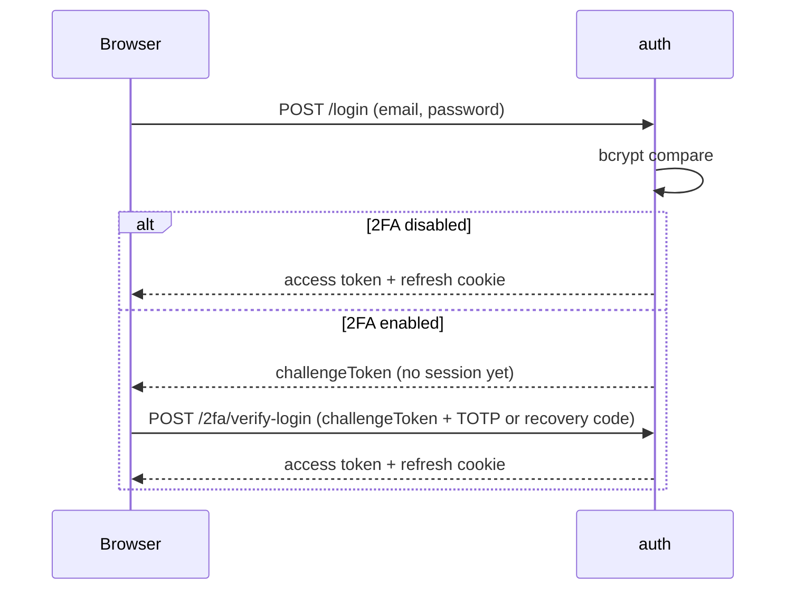
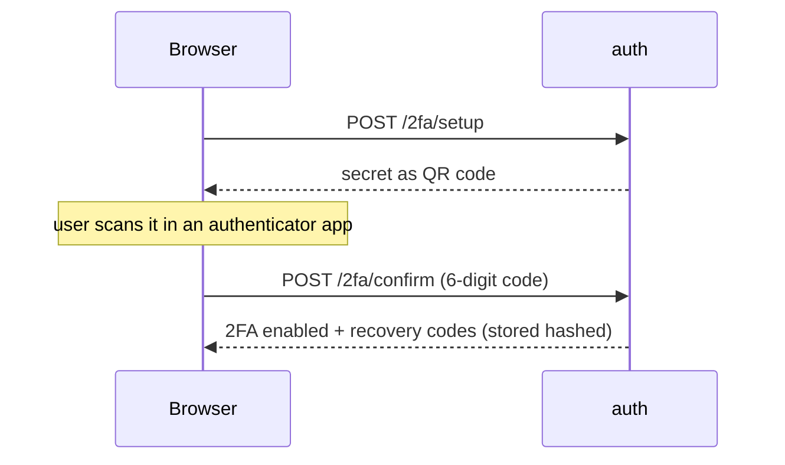
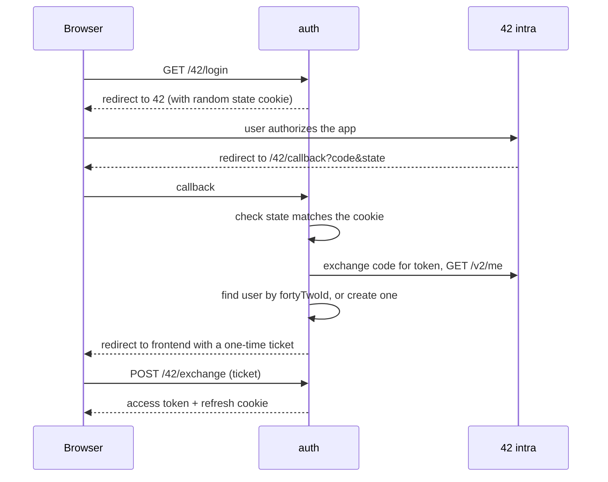

# Auth service (`auth`, port 3001, `auth_db`)

**Responsibility:** who you are — accounts, passwords, sessions, 42 login, 2FA. Owner: `hfegrach`.

## Endpoints

| Method | Path (via gateway `/api/auth/...`) | Purpose |
|---|---|---|
| POST | `/register` | Create an account |
| POST | `/login` | Email + password login |
| POST | `/refresh` | Get a new access token from the refresh cookie |
| POST | `/logout` | Clear the refresh cookie |
| GET | `/me` | Current user (needs JWT) |
| GET | `/42/login`, `/42/callback`, POST `/42/exchange` | 42 OAuth flow |
| POST | `/2fa/setup`, `/2fa/confirm`, `/2fa/disable` | Manage 2FA (needs JWT) |
| POST | `/2fa/verify-login` | Finish a login that requires 2FA |

## Sessions

- **Access token:** short-lived JWT (15 min), kept **in memory** by the frontend (not in localStorage), renewed silently before it expires.
- **Refresh token:** `httpOnly` cookie, so JavaScript cannot read it. On page reload the frontend calls `/refresh` to log back in.
- Passwords are **salted and hashed with bcrypt**; the plain password is never stored.
- Inputs are validated in the frontend (`utils/validation.ts`: username 3–20 chars, valid email, password 8–72 chars with a letter and a digit) and again in the backend.

## Login with 2FA

## Enabling 2FA

## Login with 42

If the email already belongs to a password account, the login is refused (`oauth_account_exists`); if the 42 login name is taken, a random suffix is added.