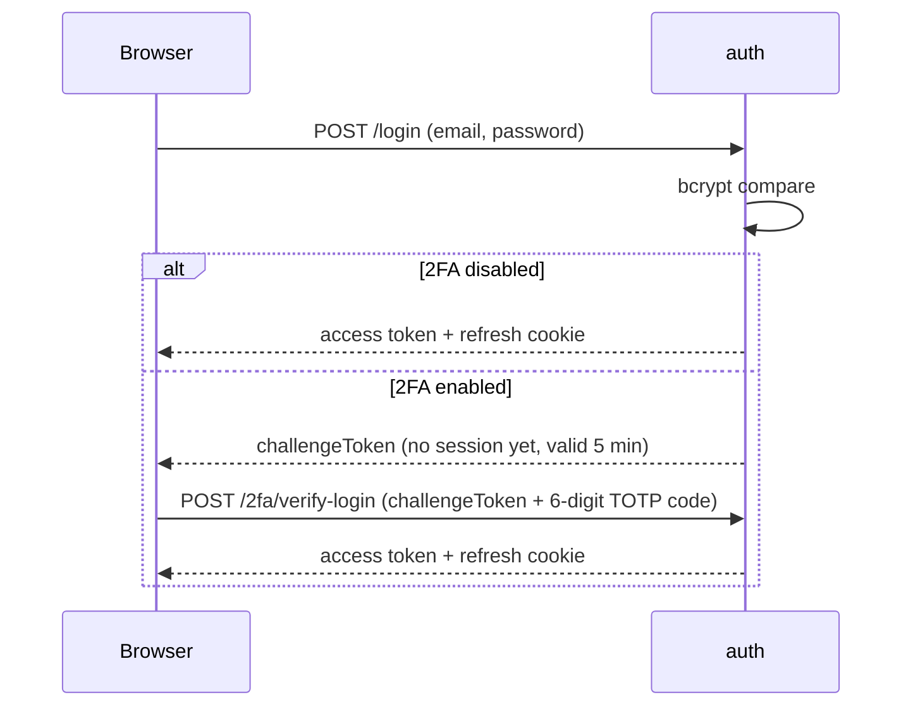
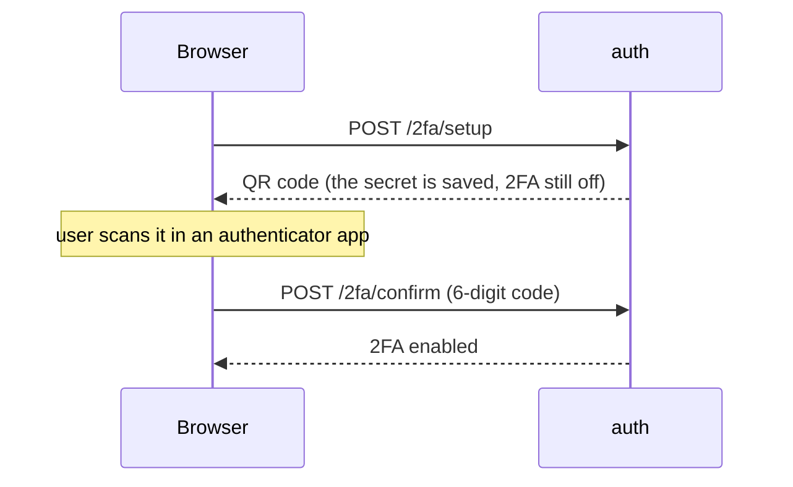
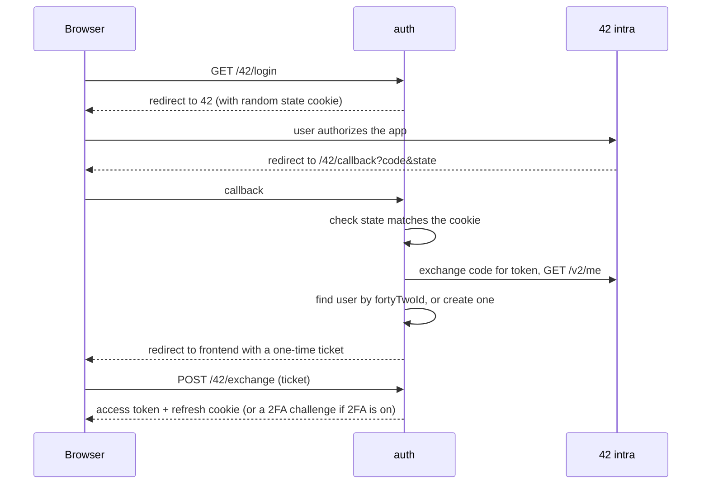

# Auth service (`auth`, port 3001, `auth_db`)

**Responsibility:** who you are — accounts, passwords, sessions, 42 login, 2FA. Owner: `hfegrach`.

## Endpoints

| Method | Path (via gateway `/api/auth/...`) | Purpose |
|---|---|---|
| POST | `/register` | Create an account |
| POST | `/login` | Email + password login |
| POST | `/refresh` | Get a new access token from the refresh cookie |
| POST | `/logout` | Clear the refresh cookie |
| GET | `/me` | Current user: `id`, `username`, `email`, `createdAt`, `twoFactorEnabled` (needs JWT) |
| GET | `/42/login`, `/42/callback`, POST `/42/exchange` | 42 OAuth flow |
| POST | `/2fa/setup`, `/2fa/confirm`, `/2fa/disable` | Manage 2FA (needs JWT) |
| POST | `/2fa/verify-login` | Finish a login that requires 2FA |
| GET | `/api/directory`, `/api/directory/:id` | Public data of the accounts (`id`, `username`, `avatar`, never the email). Through the gateway these need a JWT; it is the auth service's internal `/users` routes, which `chat` and `user` also call directly. |

## Sessions

- **Access token:** short-lived JWT (15 min), kept **in memory** by the frontend (not in localStorage), renewed silently before it expires.
- **Refresh token:** 7-day JWT in an `httpOnly`, `secure`, `sameSite=strict` cookie limited to the path `/api/auth`, so JavaScript cannot read it. On page reload the frontend calls `/refresh` to log back in (it answers `204` when there is no cookie, `401` and clears the cookie when the session is invalid).
- Passwords are **salted and hashed with bcrypt** (`bcryptjs`, cost 10); the plain password is never stored.
- Inputs are validated in the frontend (`utils/validation.ts`) and again in the backend: username 3–20 characters (letters, digits, `_` or `-`), valid email (lower-cased, max 254), password 8–72 bytes with at least one letter and one digit.

## Login with 2FA

Only a TOTP code from the authenticator app is accepted. Recovery codes are **not implemented** (the `TwoFactorRecoveryCode` table exists but is unused).

## Enabling 2FA

`/2fa/disable` turns 2FA off and deletes the secret. Enabling and disabling 2FA each create a `two_factor_changed` notification (through the chat service).

## Login with 42

The `state` cookie lives 5 min. The ticket lives **60 s**, is kept in the memory of the auth service and works only once. If the email already belongs to a password account, the login is refused (`oauth_account_exists`); if the 42 login name is taken, a random suffix is added. A 42 user has no password (`passwordHash` is null), so the email + password login never works for them.