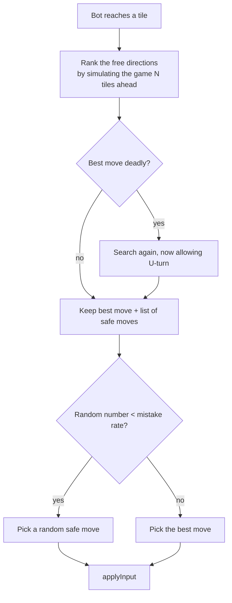

# AI bot

**Owner:** `machaouk`.

The bot runs **in the browser** on the same engine as the local game (`frontend/src/engine/bot.ts`, page `pages/Game/GameBot.tsx`). It is a second Pac-Man in the maze with id `ai`; the human plays with arrows or WASD.

The bot only decides when it is exactly on a tile (30 ticks/s, one tile every 8 ticks). Bot games are **local**: they are not saved in the match history, statistics, leaderboard or achievements.

## How it decides

- **Look-ahead:** each direction is tested on a copy of the game, played for one tile with the real engine, then the search goes `depth` tiles deep (later tiles count 0.9×).
- **Score of a move:** points won by the engine (pellets, power pellets, frightened ghosts) minus a huge penalty if the bot loses a life. At the last level, positions close to a pellet are preferred (distance computed with BFS).
- **No pointless U-turns**, unless it is the only way to survive.
- **Human-like:** with a probability `mistake` it picks a worse but survivable move, so it can lose.

## Difficulty

| Level | Look-ahead depth | Mistake probability |
|---|---|---|
| easy | 2 | 50 % |
| normal | 4 | 15 % |
| hard | 6 | 5 % |

The player also chooses the maze (3 available) and the time limit before the match. The difficulty chosen on that screen only changes the bot: the 4 ghosts always move at the default `normal` speed in bot games.

## Winner

Same rules as the online game: the player who still has lives wins, otherwise the higher score, otherwise a draw.