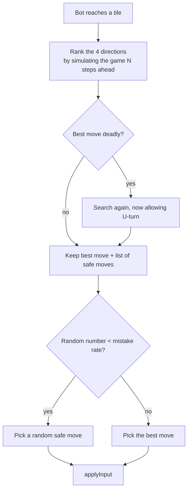

# AI bot

**Owner:** `machaouk` (algorithm and bot game page). Pac-Man / ghost images and game components were created by `nel-khad` and reused.

The bot runs **in the browser** on the same engine as the local game (`frontend/src/ai/bot.ts`, page `pages/Game/GameBot.tsx`). It is a second Pac-Man in the maze with id `ai`.

## How it decides

- **Look-ahead:** each direction is scored by simulating the engine `depth` steps: pellets and power pellets add value, being caught is a huge penalty, edible ghosts attract the bot, dangerous ghosts repel it.
- **No pointless U-turns** unless it is the only way to survive.
- **Human-like:** with a probability `mistake` it picks a worse but survivable move, so it can lose.

## Difficulty

| Level | Look-ahead depth | Mistake probability |
|---|---|---|
| easy | 2 | 30 % |
| normal | 4 | 15 % |
| hard | 6 | 5 % |

The bot plays on whichever of the 3 mazes the player chooses.