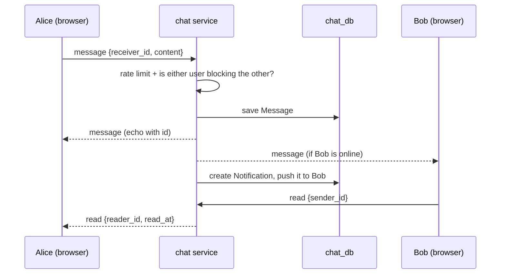
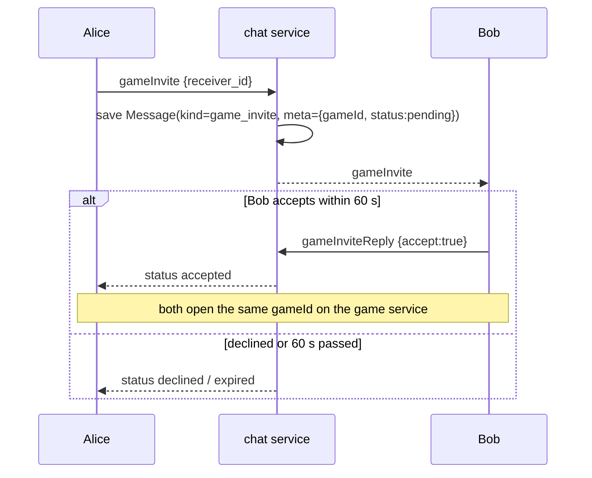
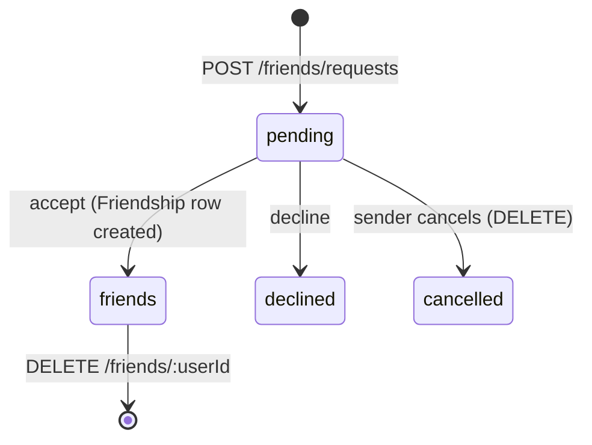

# Chat service (`chat`, port 3003, `chat_db`)

**Responsibility:** everything social and real-time — messages, online presence, blocking, friends, notifications. Owners: `machaouk` (chat), `oelmanso` (friends), `hfegrach` (notifications).

## Two channels

| Channel | Used for |
|---|---|
| **REST** (`/api/chat/...`) | History and actions: `GET /messages/:friendId`, `/friends`, `/friends/requests`, `/blocks/:id`, `/notifications`, `/users/search` |
| **WebSocket** (`/api/chat/ws?token=`) | Live: messages, typing, read receipts, presence, game invites, notifications |

## WebSocket events (typed in `shared/types/chat-types.ts`)

| Event | Direction | Meaning |
|---|---|---|
| `message` | both | A text message |
| `typing` | both | "X is typing…" |
| `read` | both | Messages from X were read (read receipt) |
| `presence` | server → client | A friend went online / offline |
| `gameInvite` | both | Invite a friend to a game |
| `gameInviteReply` | both | Accept or decline an invite |
| `notification` | server → client | New notification |
| `error` | server → client | Something was refused |

Safety: a socket is limited to **20 messages/invites per 10 s**; messages between users who blocked each other are refused.

## Sending a message

## Game invite from chat

## Presence

The service keeps a map `userId → set of sockets` (so several tabs work). When the first socket of a user opens, friends and message partners get `presence: online`; when the last one closes, `presence: offline`.

## Friends

`Friendship` stores the two ids in sorted order (`userLowId`, `userHighId`) with a unique constraint, so the same friendship can never exist twice.

## Notifications

`notifyUser()` first **stores** the notification, then **pushes** it on the socket if the user is online. Types: `message`, `friend_request`, `friend_accepted`. The UI shows an unread counter and a Notifications page (mark one / all as read).