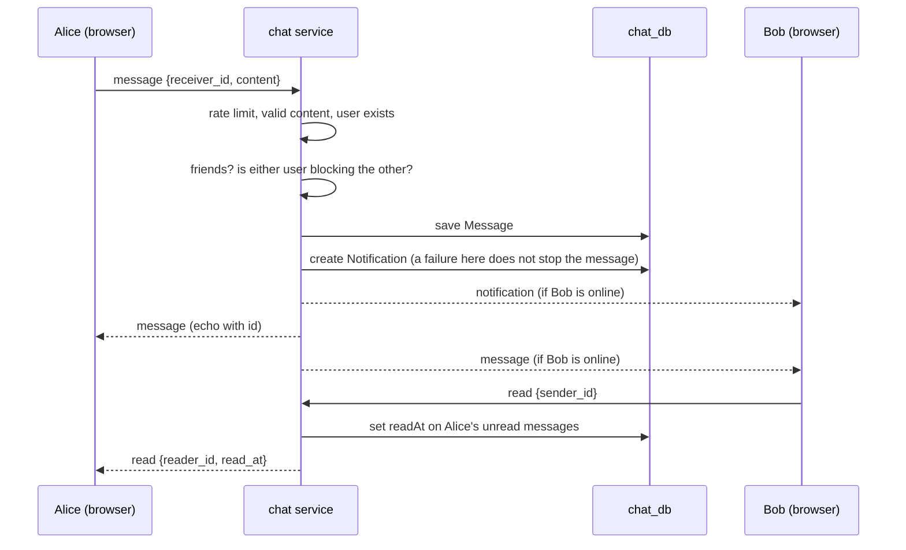
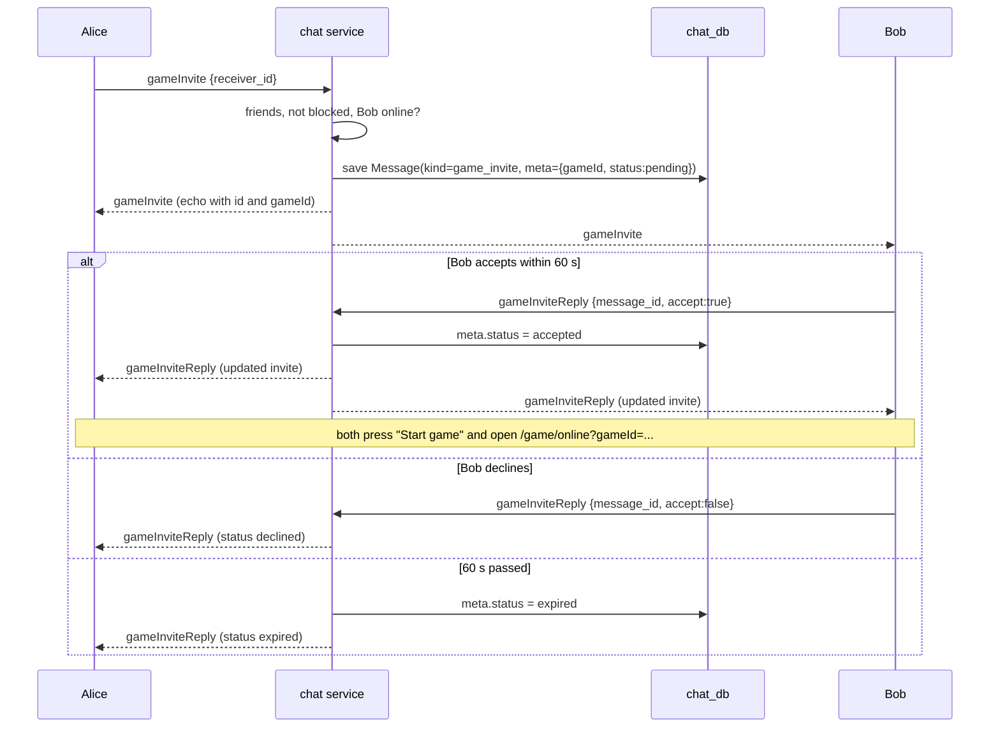
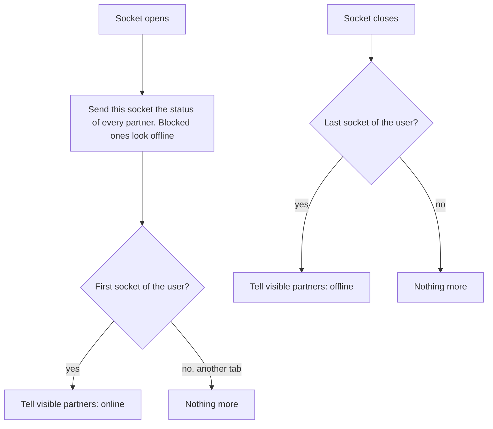
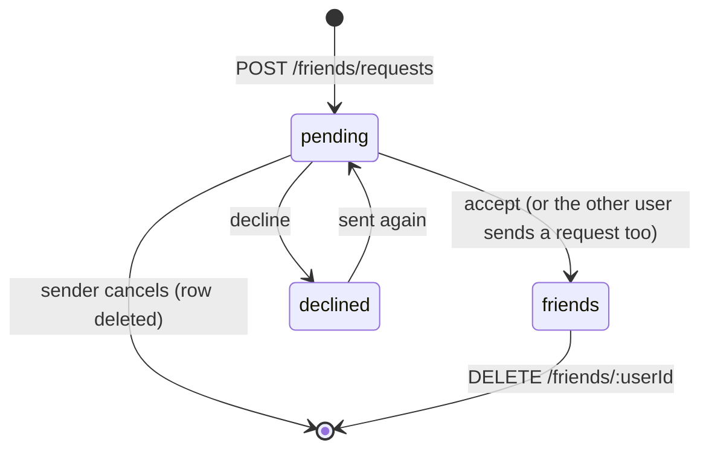

# Chat service (`chat`, port 3003, `chat_db`)

**Responsibility:** everything social and real-time — messages, online presence, blocking, friends, notifications. Owners: `machaouk` (chat), `oelmanso` (friends), `hfegrach` (notifications).

## Two channels

| Channel | Used for |
|---|---|
| **REST** (`/api/chat/...`) | History and actions (table below) |
| **WebSocket** (`/api/chat/ws?token=`) | Live: messages, typing, read receipts, presence, game invites, blocks, friend updates, notifications |

| REST route | Meaning |
|---|---|
| `GET /messages/:friendId` | History with one friend, newest first, the last 500 messages (no paging) |
| `GET /friends` | Friends list with `online` (always `false` if either side blocked) |
| `GET /friends/requests` | Pending requests, `incoming` and `outgoing` |
| `POST /friends/requests` | Send a request (or accept the pending reverse one) |
| `POST /friends/requests/:id/accept`, `/decline` | Answer an incoming request |
| `DELETE /friends/requests/:id` | Cancel my outgoing request |
| `DELETE /friends/:userId` | Remove a friend |
| `GET /users/search?q=` | Find users (max 20, never returns the email) with their `relation` to me |
| `GET /blocks`, `POST` / `DELETE /blocks/:id`, `GET /blocks/status/:id` | Blocked list, block, unblock, and who blocked whom |
| `GET /notifications?cursor=&limit=&unread=`, `/notifications/unread-count`, `PATCH /notifications/:id/read`, `POST /notifications/read-all`, `DELETE /notifications[/:id]` | Notifications (`limit` default 20, max 50; `unread=true` keeps only unread ones) |
| `POST /internal/notifications` | Used by other services only (needs the `x-internal-key` header; the gateway answers 404 for `/chat/internal`) |

## WebSocket events (typed in `shared/types/chat-types.ts`)

| Event | Direction | Meaning |
|---|---|---|
| `message` | both | A text message (the server sends it back to the sender too, with its id) |
| `typing` | both | "X is typing…" (not saved) |
| `read` | both | Messages from X were read (read receipt) |
| `presence` | server → client | A friend went online / offline |
| `gameInvite` | both | Invite a friend to a game |
| `gameInviteReply` | both | Accept / decline an invite; the server answers with the updated invite (accepted, declined, expired) |
| `notification` | server → client | New notification |
| `block_updated` | server → client | Sent to both users when one blocks / unblocks the other |
| `friend_removed` | server → client | A friendship ended (sent to both users) |
| `error` | server → client | Something was refused |

The friends routes also push `friend_request`, `friend_request_cancelled`, `friend_request_declined` and `friend_accepted` on the same socket, so the Friends page can refresh its lists.

Safety, checked on every packet:

- Limit per socket: **50 packets per 10 s** (more gets `Too many requests, slow down`); a `typing` packet is ignored if the last one was less than 1 s ago.
- A message is trimmed, cannot be empty, and is limited to **1000 characters**.
- The target must be a valid user id, not myself, and must exist (checked once with the auth service).
- Messages, typing, read receipts and invites only work between **friends**, and never when either user **blocked** the other.
- A heartbeat pings every socket every 15 s and drops the ones that don't answer.

## Sending a message



## Game invite from chat



Only the invited user can answer, and only once. A late answer counts as expired. The 60 s timer lives in memory, so when the service starts it marks every invite still pending as expired.

## Presence

The service keeps a map `userId → set of sockets` (so several tabs work). Presence is shared with the user's **partners**: their friends, minus the ones who blocked them or whom they blocked.



## Blocking

`POST /blocks/:id` stores a `BlockedUser` row and sends `block_updated` to both users. A block does **not** remove the friendship: the friend stays in the list, but looks offline, the chat is disabled (messages, typing, read receipts and invites are refused), and friend requests between the two users are refused. `GET /blocks/status/:id` tells the page who blocked whom (`iBlockedThem`, `theyBlockedMe`).

## Friends



```
sequenceDiagram
    participant A as Alice (browser)
    participant C as Chat service
    participant B as Bob (browser)
    A->>C: POST /friends/requests { userId: Bob }
    C->>C: serializable transaction
    C-->>B: socket event "friend_request" + saved notification
    B->>C: POST /friends/requests/:id/accept
    C->>C: create Friendship, mark request accepted
    C-->>A: socket "friend_accepted" + presence of Bob
    C-->>B: socket "friend_accepted" + presence of Alice
    Note over A,B: each browser reloads its lists
```


`Friendship` stores the two ids in sorted order (`userLowId`, `userHighId`) with a unique constraint, so the same friendship can never exist twice. Requests are handled in serializable transactions (retried on conflict), so two users adding each other at the same time end up as friends, with no duplicates. Each change is pushed on the socket and creates a notification for the other user.

## Notifications

`notifyUser()` first **stores** the notification, then **pushes** it on every open socket of the user if they are online. Types (`shared/types/notification-types.ts`):

| Type | Created by |
|---|---|
| `message` | chat (new message) |
| `friend_request`, `friend_accepted`, `friend_declined`, `friend_request_cancelled`, `friend_removed` | chat (friends routes) |
| `profile_updated` | user service |
| `two_factor_changed` | auth service |
| `match_finished` | game service |

Other services create theirs through `POST /internal/notifications`. The UI shows an unread counter and a Notifications page (mark one / all as read, delete one / all, load more with `cursor`).

## Frontend behavior

- `useChat` loads the friends, then the last 500 messages and the block status of the selected friend (again after every reconnect, to catch up). Live events update the same state.
- The socket reconnects by itself with a growing delay (1 s, 2 s, 4 s … max 15 s); while it is down the page shows "reconnecting".
- "Typing" is sent at most every 2 s and the indicator disappears after 2 s. `read` is sent when a conversation is opened, when a message arrives and when the tab becomes visible again: ✓ = sent, ✓✓ = read.
- When an invite is accepted, both users get a "Start game" button in the conversation. A pending invite opens an accept / decline popup for the invited user.
- On mobile the friends list is a panel opened with the burger button.
- The Friends page (`/friends`) handles search, requests and the blocked list, and refreshes itself on the friend events above.