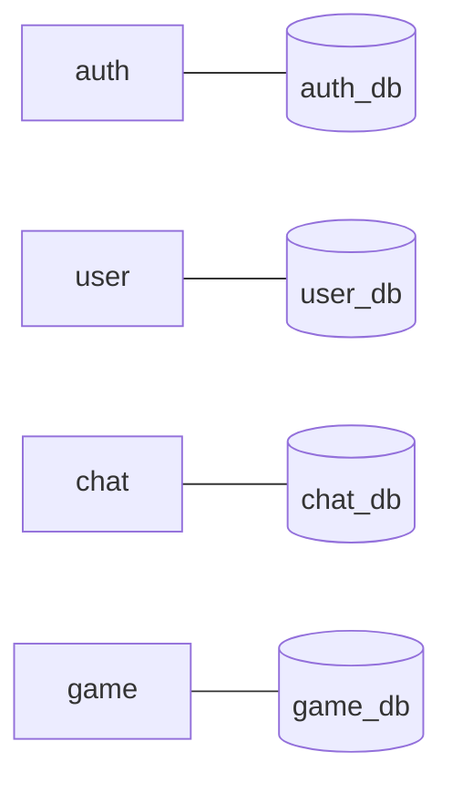
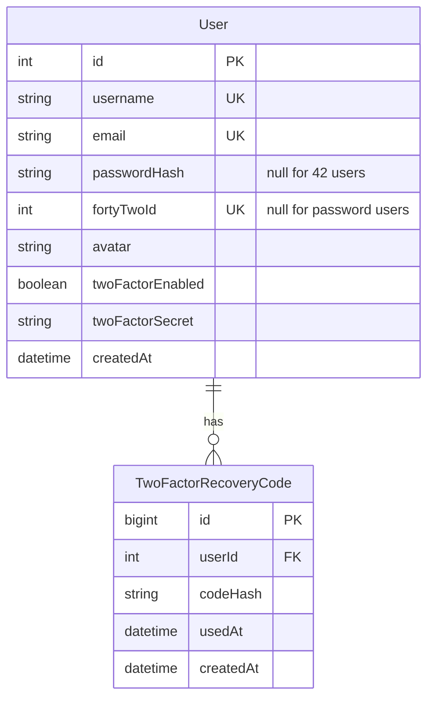
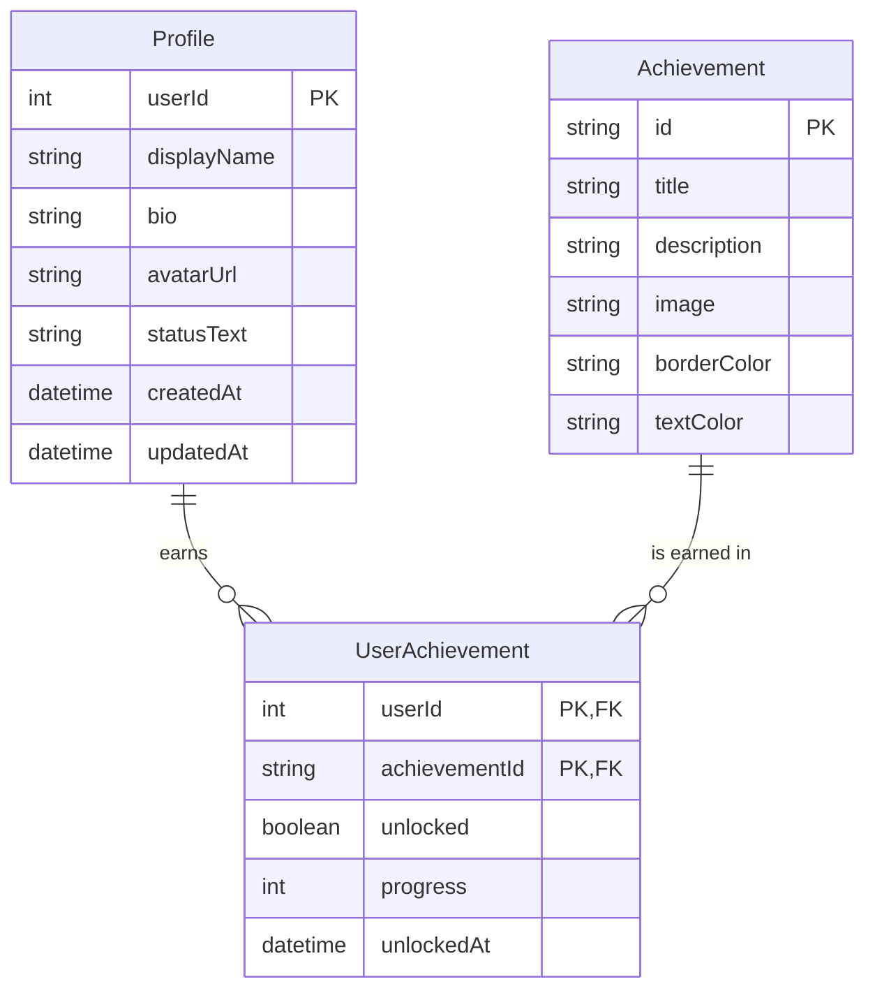
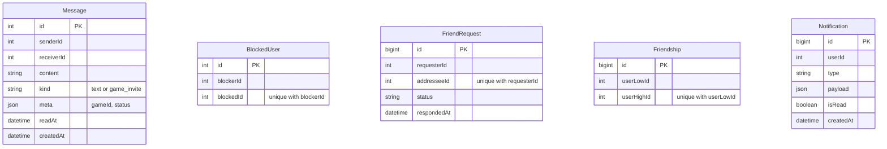
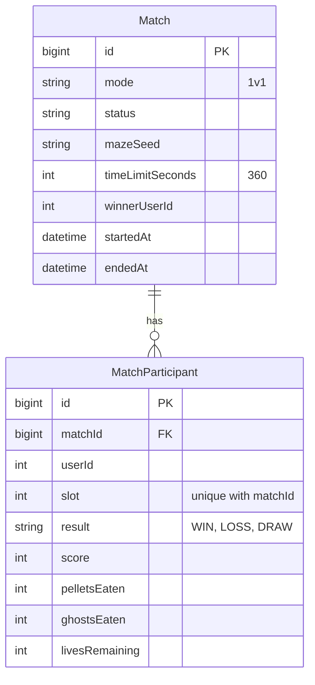

# Database

One **PostgreSQL 17** server, **four databases** (created by `postgres-db/init.sql`). Each service owns one and accesses it with **Prisma**. Services refer to users only by `userId`, never with a cross-database foreign key, so they stay independent.

## auth_db — accounts

## user_db — profiles and achievements

## chat_db — messages, friends, notifications

These tables are independent (they point to users by id, not to each other), so there are no relation lines. Indexes: messages by (`senderId`, `receiverId`, `createdAt`), notifications by (`userId`, `isRead`, `createdAt`).

## game_db — matches

`(matchId, userId)` is also unique: a player cannot appear twice in one match. Statistics and the leaderboard are computed from `MatchParticipant`.

## Migrations

Each service has its own `prisma/migrations`. They are applied automatically at container start (`prisma migrate deploy`) or manually with `make migrate`.