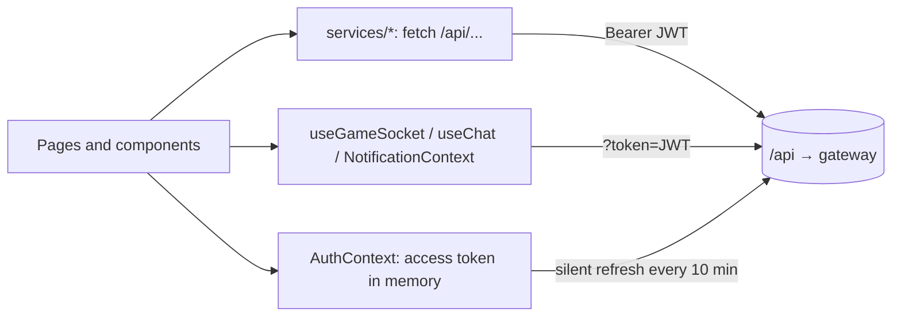

# Frontend (`frontend`, React 19 + TypeScript + Vite + Tailwind 4)

## Routes (single-page app, Back/Forward work)

| Path | Page | Access |
|---|---|---|
| `/` | Welcome | public |
| `/login`, `/signup` | Auth pages | public |
| `/privacy`, `/terms` | Privacy Policy, Terms of Service (footer links) | public |
| `/home` | Dashboard | logged in |
| `/profile`, `/profile/:userId` | Own / other player's profile | logged in |
| `/chat`, `/friends` | Chat, friends (search, requests, blocked list) | logged in |
| `/notifications` | Notifications | logged in |
| `/settings` | Account, security (2FA), appearance, language | logged in |
| `/choose` | Game mode choice (local / online / bot) | logged in |
| `/how-to-play` | Rules and controls | logged in |
| `/game`, `/game/bot`, `/game/online` | Local game, vs. bot, online | logged in |
| `/leaderboard` | Ranking | logged in |
| `*` | 404 page | public |

`ProtectedRoute` shows "Restoring session…" while the session is checked, then sends visitors who are not logged in to `/login`.

## Folder map

```
frontend/src
├── pages/        one file (or folder) per route
├── components/   ui/ (design system), game/, profile/, auth/
├── context/      AuthContext (token, refresh), NotificationContext (live notifications)
├── hooks/        useChat, useGameSocket, useLocalGame, useKeyboard, useCellSize
├── services/     fetch wrappers: user, match, leaderboard, notification
├── engine/       local copy of the game engine (maze, movement, tick) + bot.ts
├── i18n.ts       EN / FR / AR translations
├── utils/        validation, icons, notification texts
├── types/        shared front-end types (auth)
└── assets/       icons, achievement and game images
```

Event names and payloads shared with the backend are imported from the root `shared/types` and `shared/data` folders.

## Design system (`nel-khad`)

Pixel-art arcade identity, defined in `index.css` (Tailwind 4 tokens):

- **Palette:** `pacova-pink`, `pacova-green`, `pacova-purple`, `pacova-gray`, `pacova-bg`, `pacova-surface`.
- **Fonts:** Press Start 2P (titles), Pixelify Sans, VT323 (text), Inter.
- **Components** in `components/ui`: `PixelButton`, `Card`, `Input`, `Badge`, `Toast`, `Navbar`, `Footer`, `Background`, `GameModeCard`. Game and profile screens add their own reusable pieces in `components/game` and `components/profile`.
- **Themes:** dark (default) and light, chosen in Settings → Appearance and saved in `localStorage` (`pacova-theme`).

## Internationalization

`i18next` with English (default and fallback), French and Arabic. The language switcher is in Settings; the choice is saved in `localStorage` (`language`) and applied on load. For Arabic the page direction is set to right-to-left (`dir="rtl"`).

## Responsive design

Tailwind breakpoints are used throughout; **each member made their own pages responsive**. The game has touch controls (`MobileControls`) and a "rotate your device" hint on small screens.

## Data flow



- **Chat socket:** opened by `NotificationContext` (live notifications), by `useChat` (chat page) and by the Friends page; the server counts a user as online while at least one is open.
- **Game socket:** opened only on the online game page (`useGameSocket`).
- **Local and bot games** run entirely in the browser with the local engine.