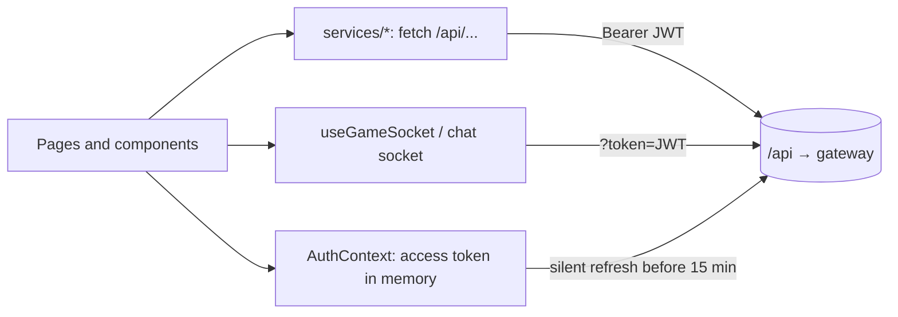

# Frontend (`frontend`, React 19 + TypeScript + Vite + Tailwind 4)

## Routes (single-page app, Back/Forward work)

| Path | Page | Access |
|---|---|---|
| `/` | Welcome | public |
| `/login`, `/signup` | Auth pages | public |
| `/privacy`, `/terms` | Privacy Policy, Terms of Service (footer links) | public |
| `/home` | Dashboard | logged in |
| `/profile`, `/profile/:userId` | Own / other player's profile | logged in |
| `/chat` | Chat and friends | logged in |
| `/notifications` | Notifications | logged in |
| `/settings` | Account, security (2FA), language | logged in |
| `/game`, `/game/bot`, `/game/online` | Local game, vs. bot, online | logged in |
| `/leaderboard` | Ranking | logged in |
| `*` | 404 page | public |

`ProtectedRoute` sends visitors who are not logged in back to the login page.

## Folder map

```
frontend/src
├── pages/        one file (or folder) per route
├── components/   ui/ (design system), game/, profile/, auth/
├── context/      AuthContext (token, refresh), NotificationContext
├── hooks/        useGameSocket, useLocalGame, useKeyboard, useCellSize
├── services/     fetch wrappers for each backend service
├── engine/       local copy of the game engine (maze, movement, tick)
├── ai/           bot.ts
├── i18n.ts       EN / FR / AR translations
└── utils/        validation, canvas rendering
```

## Design system (`nel-khad`)

Pixel-art arcade identity: palette, pixel font, icons and **more than 10 reusable components** in `components/ui` (Button, PixelButton, Card, Input, FormField, Modal, Toast, Badge, Avatar, Navbar, Footer, NeonFrame, backgrounds…). Every page is built from them, so the look stays consistent.

## Internationalization

`i18next` with English, French and Arabic. The language switcher is in Settings; the choice is saved in `localStorage` and applied on load. For Arabic the page direction is set to right-to-left.

## Responsive design

Tailwind breakpoints are used throughout; **each member made their own pages responsive**. The game has touch controls (`MobileControls`) and a "rotate your device" hint on small screens.

## Data flow

