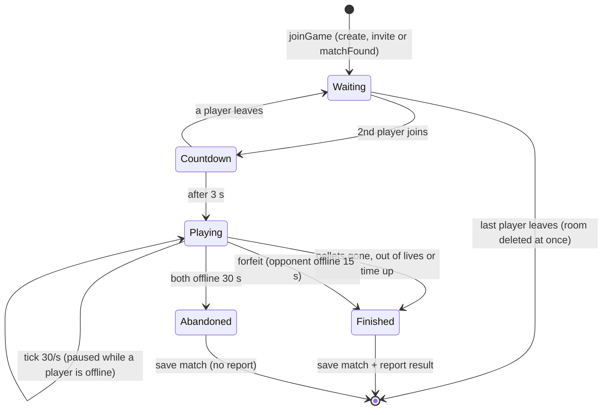
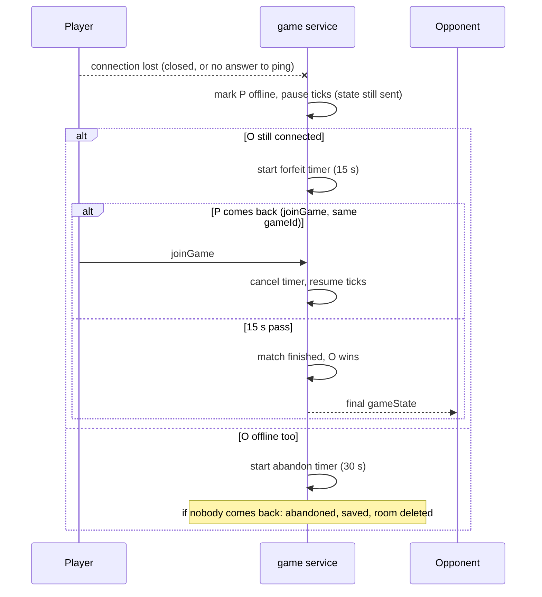
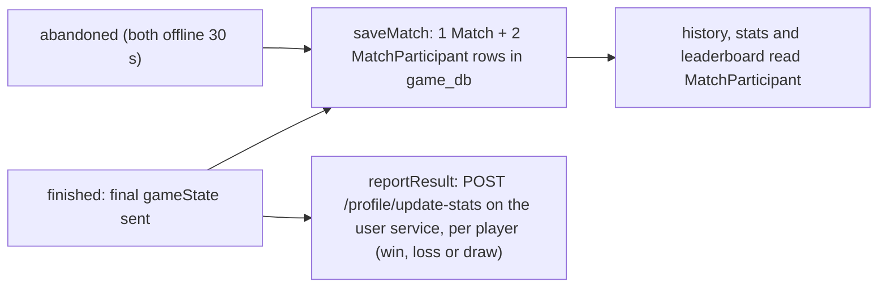

# Game service (`game`, port 3002, `game_db`)

**Responsibility:** the authoritative online Pac-Man match (rooms, matchmaking, game loop, reconnection), plus match history, statistics and the leaderboard. Owner: `ynadime`.

## The game

- **Remote 1v1:** two Pac-Mans share one maze with **4 ghosts**. They start 4 tiles left and right of the maze's `P` tile.
- **Points:** pellet **10**, power pellet **50**. A power pellet makes the ghosts **frightened for 10 s**: they flee, and eating one gives **200** (always 200) and sends it back home, where it chases again until the next power pellet.
- **Lives:** 3 each. When a player is caught, they lose a life and **everyone** (both players and all ghosts) goes back to their spawn. Frightened mode ends too.
- **End of the match:** all pellets eaten, a player out of lives, or the timer reaches 0.
- **Winner:** a player who still has lives beats one who has none. Otherwise the higher score wins, and equal scores are a **draw**.

### Match settings

The player who **creates** the room picks them. A player who joins later uses the room's settings. An unknown value falls back to the default.

| Setting | Values | Default |
|---|---|---|
| Maze | `circuit`, `arena`, `crossroads` | `circuit` |
| Time limit | 120, 240, 360 s | **240 s** |
| Ghost difficulty | `easy`, `normal`, `hard` (a ghost moves one tile every 14, 10 or 8 ticks) | `normal` |

### Ticks and tiles

The engine runs at **30 ticks per second**. A player moves one tile every **8 ticks** (3.75 tiles/s), so on `hard` the ghosts are as fast as the players. All these numbers live in `shared/data/game-data.ts` and are shared by the server and the frontend.

## Engine

| File | Role |
|---|---|
| `engine/maze.ts` | Wall checks, pellets, spawns (`P` for players, `E` for ghosts) |
| `engine/movement.ts` | "Tile ahead", player and ghost steps (turns are buffered until the next tile) |
| `engine/engine.ts` | `createGame`, `addPlayer`, `applyInput`, `tick` (movement, pellets, ghosts, collisions, lives, timer, winner) |
| `gameSessions.ts` | In-memory map of rooms: `gameId` → game state |
| `websocket.ts` | Sockets, rooms, matchmaking, game loop, forfeit and abandon timers |

- **Ghosts:** at each new tile, a ghost picks the free direction (no wall, no other ghost there or heading there) that brings it **closest to the nearest player**, or **farthest** when frightened. It never turns back unless it's at a dead end, and ties are broken at random. All four ghosts use the same rule.
- **Collisions:** a player and a ghost touch when they're on the same tile, or when they're on neighboring tiles moving toward each other. The second case is needed because ghosts move after the check: without it, the two could swap tiles head-on without ever being on the same tile when the check runs. All the collisions of a tick are found first and applied after, so both players are treated the same: both can lose a life in the same tick, and if both touch the same frightened ghost, both get the 200 points.
- **Frontend copy:** `frontend/src/engine` (plus `bot.ts`) runs the local 2-player game and the bot. It has the same movement, ghost and collision rules, and fixes go into both copies. Only the end differs: the server picks a winner (`finished` + `winnerId`), while the local copy only sets `won` or `lost`.
- **Online, only the server's copy is trusted.** Clients only send directions and draw the state they receive.

## Endpoints

Everything goes through the gateway, which checks the JWT (`Authorization: Bearer` for REST, `?token=` for the WebSocket) and passes the user id as `x-user-id`. The player's identity always comes from that header, never from a message.

| Type | Path | Purpose |
|---|---|---|
| REST | `GET /api/game/matches/:id?` `?limit=&offset=` | A user's match history (yourself by default), newest first, 5 per page (max 50), each with both players |
| REST | `GET /api/game/stats/:id?` | `matchesPlayed`, `wins`, `losses`, `draws`, `winRate`, `pelletsEaten`, `ghostsEaten` |
| REST | `GET /api/game/leaderboard?limit=` | `[{ userId, wins }]`, ranked by wins, 10 by default (max 100) |
| WS | `/api/game/ws?token=` | Matchmaking, rooms, inputs, live state |

- An invalid `:id` gets `400 Invalid user id`.
- The leaderboard only returns ids. The Leaderboard page (`hfegrach`) gets the names from the user service.
- The service also answers `GET /health` and `GET /whoami` (returns your id, for debugging).

## WebSocket

Every message is a JSON envelope `{ event, data }`, typed in `shared/types/game-types.ts`.

| Event | Direction | Meaning |
|---|---|---|
| `queue` | client → server | Search for an opponent |
| `leaveQueue` | client → server | Stop searching. The server supports it, but the client closes the socket instead, which has the same effect. |
| `matchFound {gameId}` | server → client | Opponent found, join this room |
| `joinGame {gameId, mazeId?, timeLimit?, difficulty?, intent?}` | client → server | Create, join or rejoin a room (see below). The settings are only used when the room is created. |
| `playerInput {gameId, direction}` | client → server | `UP`, `DOWN`, `LEFT` or `RIGHT`. The turn happens at the next tile where it's possible. |
| `gameState` | server → client | The full state: players, ghosts, pellets, timer, status, winner. Sent when someone joins or leaves the lobby, then on every tick. |
| `error {message}` | server → client | A refused request (see below) |

- `joinGame` also carries a `username`, but the server ignores it and uses the id from the token.
- `gameStart` and `gameOver` exist in the types but are never sent. The end of a match is a `gameState` with status `finished`.

**Safety:**

- Messages are limited to **4 KB**. A bigger one closes the socket.
- Every message is checked (shape, event name, room name, direction). A bad one gets an `error`, never a crash.
- The server **pings every 5 s** and drops a socket that didn't answer the previous ping, so a dead connection is noticed within about 10 s.

## Rooms: create, join, rejoin

A room is identified by its name, the `gameId`. What `joinGame` does depends on `intent`:

| `intent` | Sent by | Room exists | Room doesn't exist |
|---|---|---|---|
| `"create"` | the Create form | `Room name is already taken` | created |
| `"join"` | the Join form, and every automatic reconnect | joined | `Room not found` |
| none | invite links (`/game/online?gameId=`), a page refresh, matchmaking | joined | created |

- **Room names:** 1 to 36 characters and not blank, checked by the server. 36 is the length of the UUIDs that matchmaking uses. The forms also trim the name and limit it to 20 characters.
- **Refresh:** the room stays in the URL (`?gameId=`), so a refresh rejoins the same room, in the lobby or mid-match.
- **Second tab:** a new connection from the same account replaces the old one, which is closed with code `4000` ("Replaced by a new connection").

| `error` message | When |
|---|---|
| `Invalid room name` | Blank, or longer than 36 characters |
| `Room not found` / `Room name is already taken` | See the `intent` table |
| `This room is full, try another one` | 2 players are in and you're not one of them |
| `This connection already joined a game` | One socket can only be in one room |
| `You're already searching for a match` | The same account queued twice |
| `Game not found` | An input for a room that doesn't exist |
| `Invalid JSON`, `Invalid message`, `Unknown event`, `Invalid gameId`, `Invalid direction` | Malformed messages, which the official client never sends |

## Match lifecycle

The countdown isn't a separate status: the state stays `waiting`, and the lobby shows "Starting in 3".

## Matchmaking

There's a **single waiting slot**, not a full queue. The first player waits there. When a different account sends `queue`, the server makes a random UUID as the `gameId` and sends `matchFound` to both. Each client then closes its matchmaking socket and opens the game socket with `joinGame` (no `intent`).

- The same account can't queue twice.
- Leaving (`leaveQueue`, Cancel, or a closed socket) frees the slot.
- If the matchmaking socket closes unexpectedly, the client goes back to the menu with "Lost connection while searching for a match".

## Disconnection and reconnection

**Server:**

- Ticks only run while **both players are connected**, so nobody gets caught (or loses time) while offline. The timer pauses too.
- **Lobby:** a player who leaves is removed at once, the countdown is cancelled, and an empty room is deleted at once. There's no timer in the lobby.
- If both were offline and one comes back, a forfeit timer starts for the other one.
- An error inside the game loop is caught: the match is dropped (not saved), and the service keeps running.

**Client** (`frontend/src/hooks/useGameSocket.ts`):

- **Retries:** after an unexpected close, it tries again up to **3 times, 2 s apart**. Each attempt times out after 3 s, and the count resets when a message arrives. A reconnect always sends `intent: "join"`.
- **No retry** after code `4000` (another tab took over) or once the match is finished.
- **Token renewal** (every 10 min) doesn't reconnect. The socket URL is kept in a ref and read at each connect, so retries use the newest token.
- **Mid-match**, a "Connection lost" box shows the 15 s countdown. After the retries fail, it offers Play Again / Back To Menu.
- **Server errors** that arrive in the lobby or mid-match, like `Room not found` after a server restart, send the player back to the screen they came from (the Create/Join form or the menu), with the message.

## When a match ends

- **`MatchParticipant.result`:** `WIN`, `LOSS`, `DRAW` or `ABANDONED`.
- **`reportResult`:** a failure is only logged, and the match is unaffected. Abandoned matches aren't reported.
- **Stats:** `matchesPlayed` counts every match, abandoned ones included. `winRate` = wins ÷ (wins + losses + draws), so abandoned matches don't lower it. It's 0 with no finished match, and the totals are 0 with no match at all.
- **Leaderboard:** the number of `WIN` rows per user.

## Frontend files

| File | Role |
|---|---|
| `pages/OnlineGame.tsx` | Menu, Create/Join forms, matchmaking screen, room kept in the URL |
| `components/game/Matchmaking.tsx` | The matchmaking socket |
| `components/game/GameRoom.tsx` | Lobby, match, result, "Connection lost" box, error handling |
| `hooks/useGameSocket.ts` | The game socket: join, inputs, retries |
| `components/game/MazeUI.tsx` | Draws the maze, players and ghosts |
