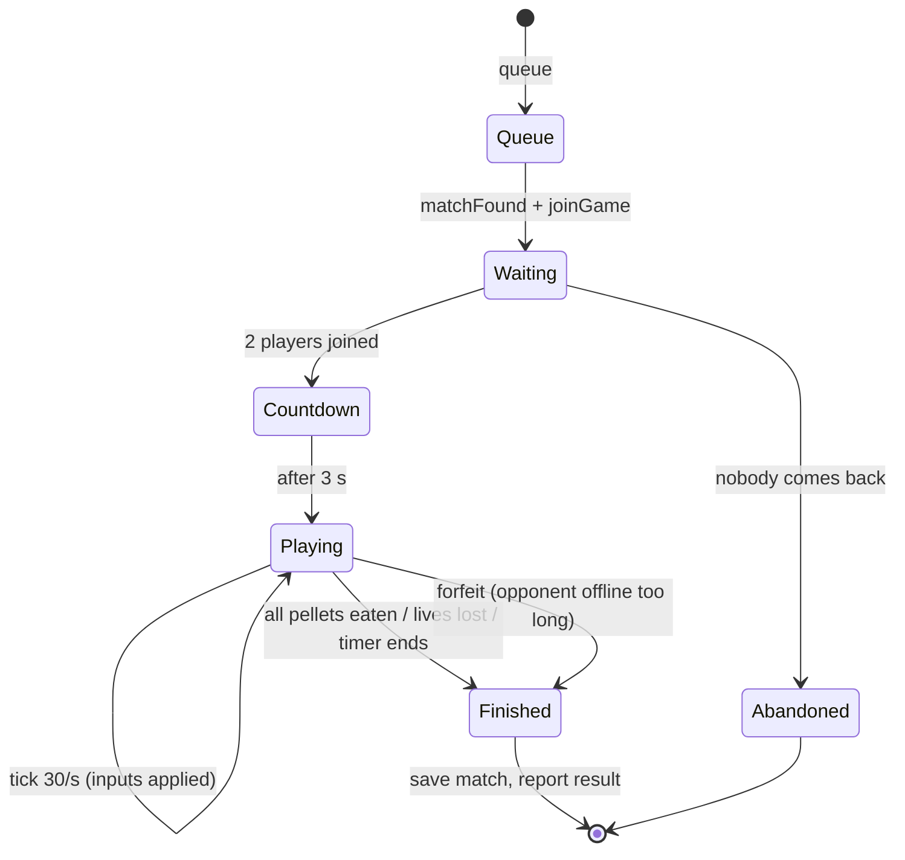
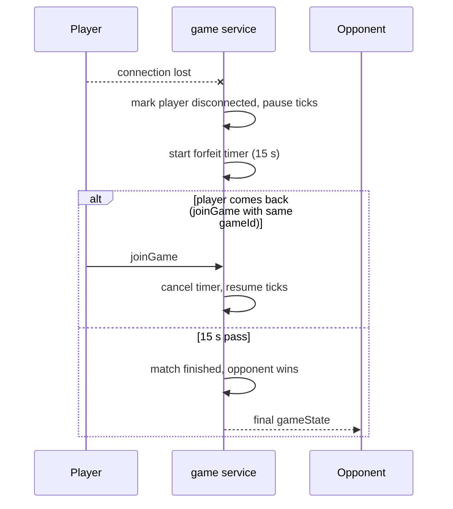
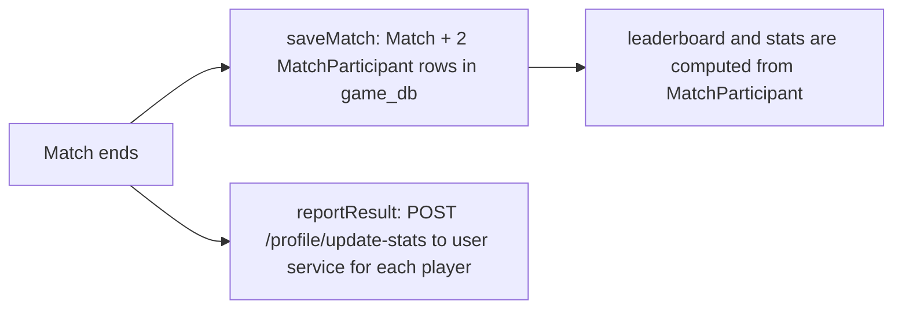

# Game service (`game`, port 3002, `game_db`)

**Responsibility:** the authoritative online Pac-Man match, plus statistics, match history and leaderboard. Owner: `ynadime`.

## The game

- Original Pac-Man rules: pellets (10 pts), power pellets (50 pts, ghosts become edible), 3 lives, a time limit (360 s by default).
- **Remote 1v1: two Pac-Mans** share one maze; the higher score wins (draw possible).
- Three mazes: `circuit` (default), `arena`, `crossroads`.
- Time is cut in **tiles** and **ticks**: the engine runs at **30 ticks per second**; a player moves one tile every few ticks.

## Engine files

| File | Role |
|---|---|
| `engine/maze.ts` | Maze layouts and wall checks |
| `engine/movement.ts` | Direction, "tile ahead", step counter |
| `engine/engine.ts` | `createGame`, `applyInput`, `tick` (movement, pellets, ghosts, lives, timer, winner) |

The **same engine logic** exists in the frontend (`frontend/src/engine`) and is used for the local game and the bot; online, only the server's copy is trusted.

## Endpoints

| Type | Path | Purpose |
|---|---|---|
| REST | `GET /matches/:id?` | Match history of a user |
| REST | `GET /stats/:id?` | Matches played, wins, losses, draws, win rate, pellets and ghosts eaten |
| REST | `GET /leaderboard?limit=` | Users ranked by number of wins |
| WS | `/api/game/ws?token=` | Queue, join, inputs, state |

## WebSocket events (typed in `shared/types/game-types.ts`)

| Event | Direction | Meaning |
|---|---|---|
| `queue` / `leaveQueue` | client → server | Search / stop searching for an opponent |
| `matchFound {gameId}` | server → client | Opponent found |
| `joinGame {gameId, mazeId?}` | client → server | Enter the room |
| `playerInput {gameId, direction}` | client → server | UP / DOWN / LEFT / RIGHT |
| `gameState` | server → client | Full authoritative state (players, ghosts, pellets, score, timer, status) |
| `error {message}` | server → client | Invalid input, room full, already searching… |

## Match lifecycle

## Matchmaking

A simple first-in-first-out queue: the first player waits; when a second (different) player sends `queue`, the server creates a random `gameId` and sends `matchFound` to both. A player can't queue twice and leaving the queue (or closing the socket) removes them.

## Disconnection and reconnection

- The game loop only ticks while **all players are connected**, so nobody loses because of a lag spike.
- If a match is left empty in the waiting state, an abandon timer (30 s) cleans the session up.
- A new connection of the same user replaces the old one (no ghost sockets).
- Crashes in the loop are caught: the match ends and the server keeps running.

## When a match ends

Leaderboard query: count of `MatchParticipant` rows with `result = "WIN"`, grouped by user (`hfegrach`).