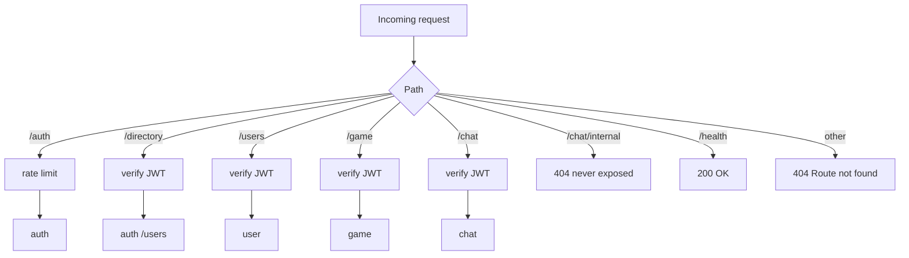
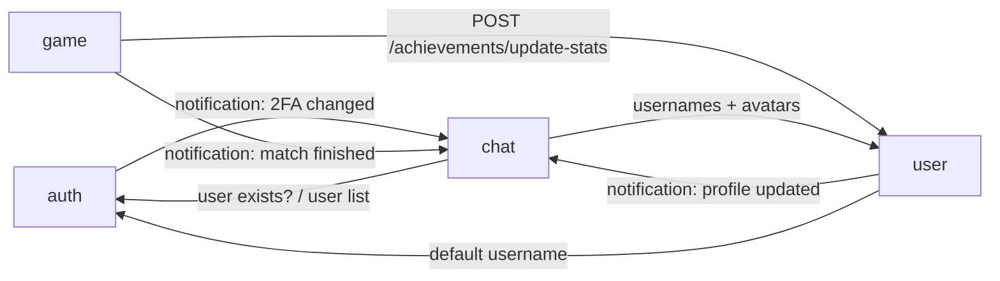
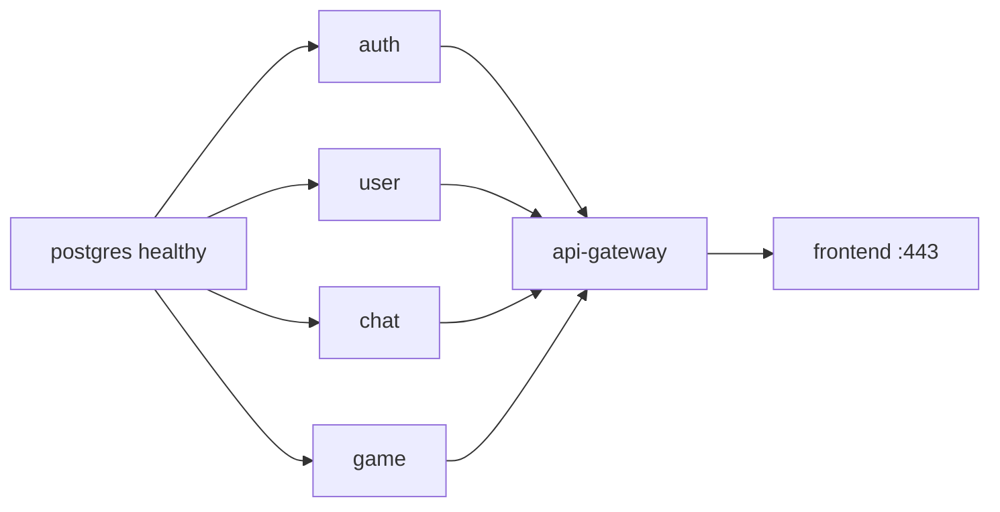

# Gateway and infrastructure

Owner: `machaouk`.

## NGINX (container `frontend`)

- Built in two stages: Node builds the React app, then NGINX serves `dist/`.
- Generates a **self-signed TLS certificate** at build time (TLS 1.2 / 1.3).
- Ports: **443** (HTTPS) and **8080**, which only redirects to HTTPS.
- Routes:

| Location | Goes to |
|---|---|
| `/` | React single-page app (`try_files … /index.html` so refresh and Back/Forward work) |
| `/api/` | `api-gateway:3000` (prefix removed, WebSocket upgrade headers kept, 1 h timeouts) |
| `/uploads/` | `user:3004/uploads/` (avatar files, public) |

- Upload limit: 6 MB (the user service itself accepts avatars up to 2 MB).

## API gateway (container `api-gateway`)

- **REST:** `/auth` is public but rate-limited (**100 failed requests / 15 min** per IP; successful requests and `/refresh` are not counted). Every other route needs a valid JWT. The matched prefix is removed before proxying (`/chat/friends` → chat `/friends`).
- **WebSocket:** on `upgrade`, the token is read from `?token=`, verified (HS256), and the user id is forwarded as `x-user-id`. `/game/ws` goes to the game service, `/chat/ws` to the chat service, anything else gets 404.
- If a service is down the gateway answers **502** with a clear message instead of crashing.
- Fails at startup if `JWT_SECRET` is missing (no silent default).

## Service-to-service calls

Services also call each other directly on the Docker network (no JWT, the gateway is not involved).

Notifications go to `POST chat:3003/internal/notifications`, protected by the `x-internal-key` header (= `INTERNAL_API_KEY` in `.env`). That route is not reachable from outside (the gateway returns 404 for `/chat/internal`).

## Docker Compose

- Services: `postgres`, `auth`, `user`, `chat`, `game`, `api-gateway`, `frontend`.
- Network `pacova` (bridge); volumes `postgres_data` (databases) and `uploads_data` (avatars, mounted in `user`).
- `postgres` has a healthcheck; `auth`, `user`, `chat`, `game` wait for it (`service_healthy`). `api-gateway` waits for the four services to start, `frontend` for the gateway.
- Each service container runs `prisma migrate deploy` before starting, so the schema is always up to date (`user` also runs its achievements seed).
- `postgres-db/init.sql` creates the four databases on first start.
- Secrets come from `.env` (never committed; template in `.env.example`).

