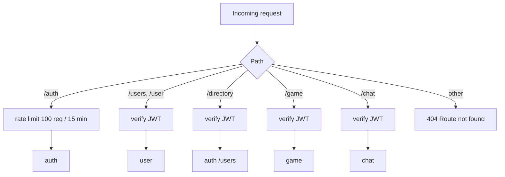
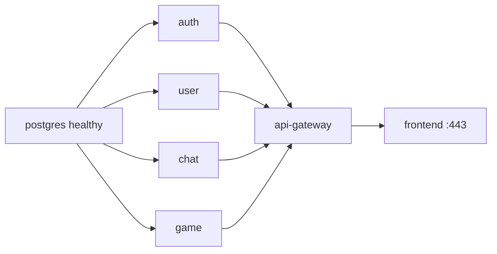

# Gateway and infrastructure

## NGINX (container `frontend`)

- Built in two stages: Node builds the React app, then NGINX serves `dist/`.
- Generates a **self-signed TLS certificate** at build time; only port **443** is published.
- Routes:

| Location | Goes to |
|---|---|
| `/` | React single-page app (`try_files … /index.html` so refresh and Back/Forward work) |
| `/api/` | `api-gateway:3000` (prefix removed, WebSocket upgrade headers kept, 1 h timeouts) |
| `/uploads/` | `user:3004/uploads/` (avatar files) |

- Upload limit: 6 MB.

## API gateway (container `api-gateway`)

- **REST:** `/auth` is public but rate-limited; every other route needs a valid JWT.
- **WebSocket:** on `upgrade`, the token is read from `?token=`, verified (HS256), and the user id is forwarded as `x-user-id`. `/game/ws` goes to the game service, `/chat/ws` to the chat service, anything else gets 404.
- If a service is down the gateway answers **502** with a clear message instead of crashing.
- Fails at startup if `JWT_SECRET` is missing (no silent default).

## Docker Compose

- Services: `postgres`, `auth`, `user`, `chat`, `game`, `api-gateway`, `frontend`.
- Network `pacova` (bridge); volume `postgres_data`.
- `postgres` has a healthcheck; `auth`, `user`, `chat`, `game` wait for it (`service_healthy`).
- Each service container runs `prisma migrate deploy` before starting, so the schema is always up to date.
- `postgres-db/init.sql` creates the four databases on first start.
- Secrets come from `.env` (never committed; template in `.env.example`).

Owner: `machaouk`.