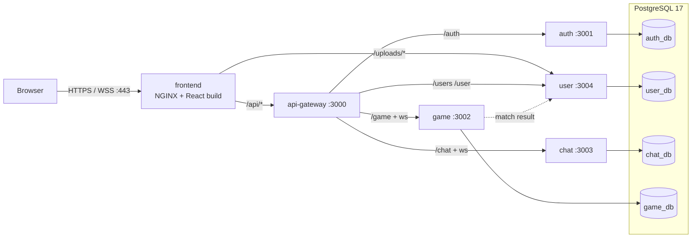
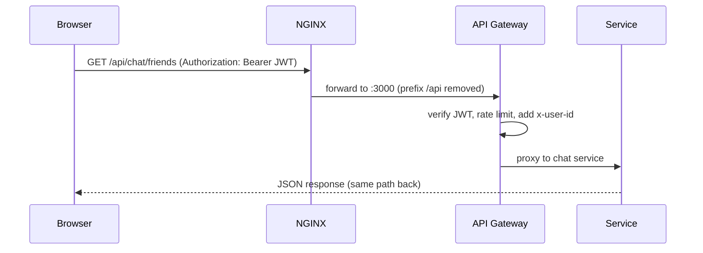
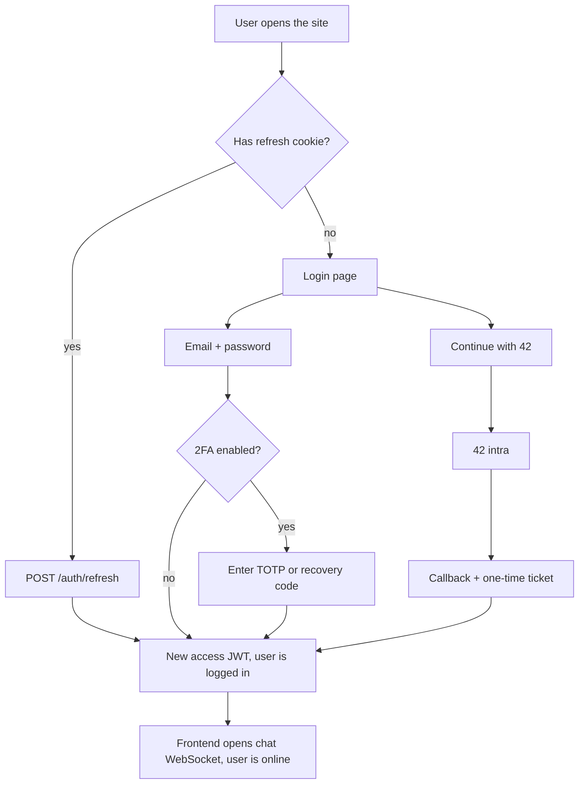
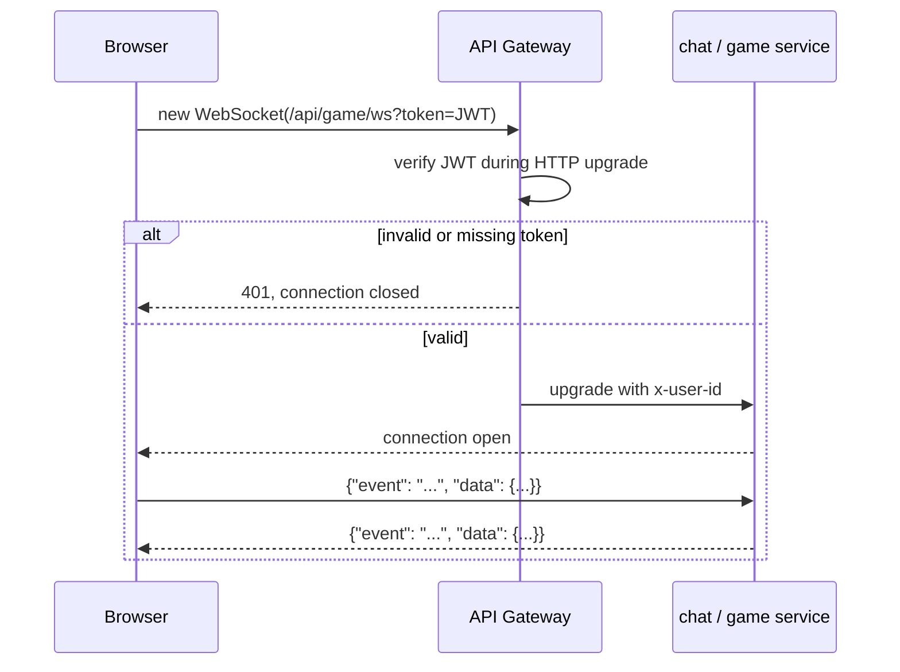
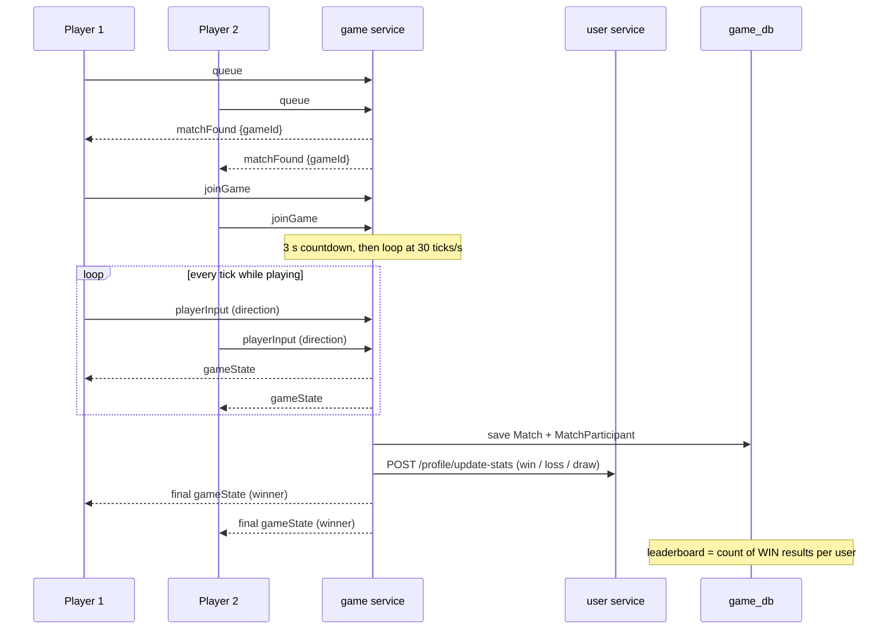

# Overview — how PACOVA works

## 1. The containers

Only **one port is public (443)**. Everything else lives on the private Docker network `pacova`.

## 2. Life of a request

Services never check passwords or tokens themselves for REST: the gateway verifies the JWT and tells them **who** the user is with the `x-user-id` header.

## 3. Login workflow

## 4. WebSocket workflow (chat and game)

All messages use the same envelope `{event, data}`; event names and payloads are typed once in `shared/types` and imported by frontend and services.

## 5. A full online game, from click to leaderboard

## 6. Where to read next

Each box above has its own page — see the [index](../README.md).