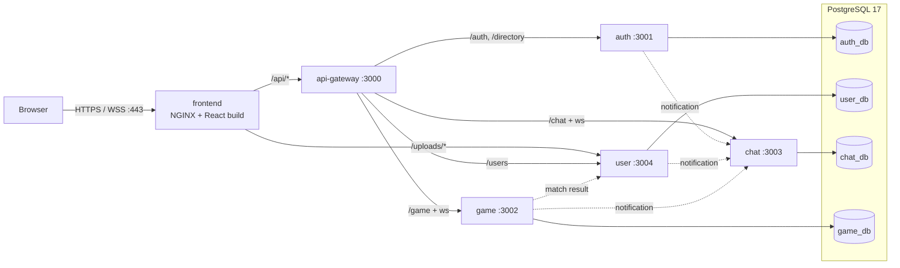
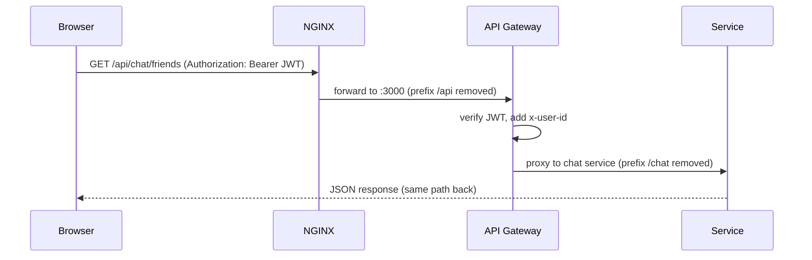
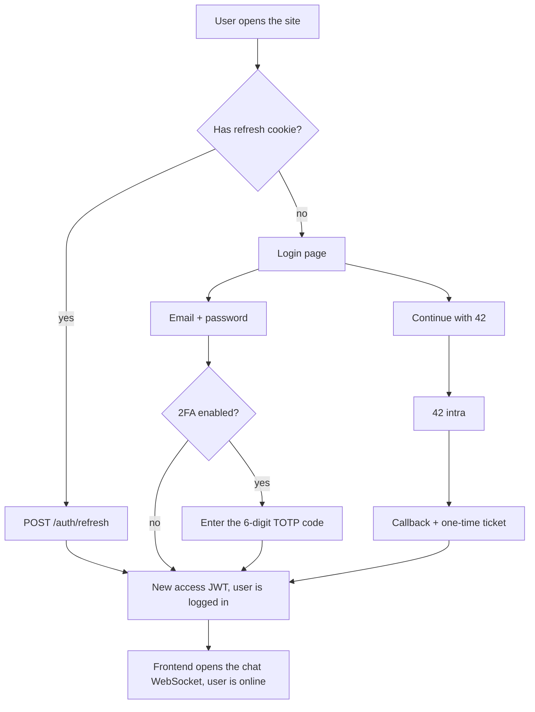
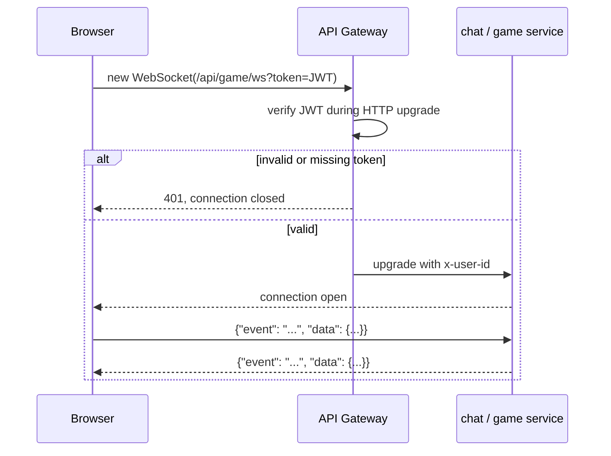
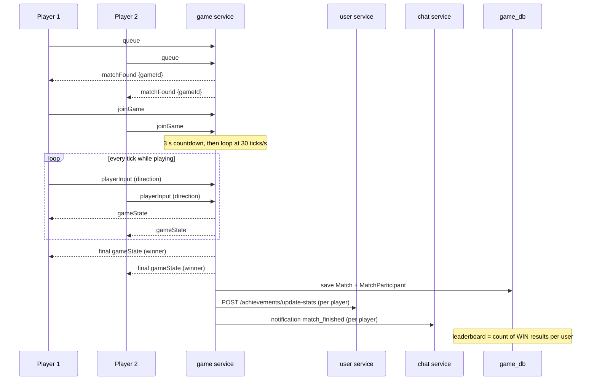

# Overview — how PACOVA works

## 1. The containers

The app is served on **port 443 (HTTPS)**; port 8080 only redirects to it. Everything else lives on the private Docker network `pacova`.

Dotted arrows are internal calls between services (they do not go through the gateway).

## 2. Life of a request

For `/chat`, `/game`, `/users` and `/directory`, services never check tokens themselves: the gateway verifies the JWT and tells them **who** the user is with the `x-user-id` header. `/auth` is public (rate-limited); the auth service checks tokens itself where needed (`/me`, `/2fa/*`).

## 3. Login workflow

The access JWT lives **15 min** (kept in memory, renewed every 10 min). The refresh cookie lives **7 days** (`httpOnly`).

## 4. WebSocket workflow (chat and game)

All messages use the same envelope `{event, data}`; event names and payloads are typed once in `shared/types` and imported by the frontend and the services.

## 5. A full online game, from click to leaderboard

## 6. Where to read next

Each box above has its own page — see the [index](../README.md).