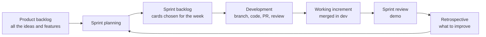
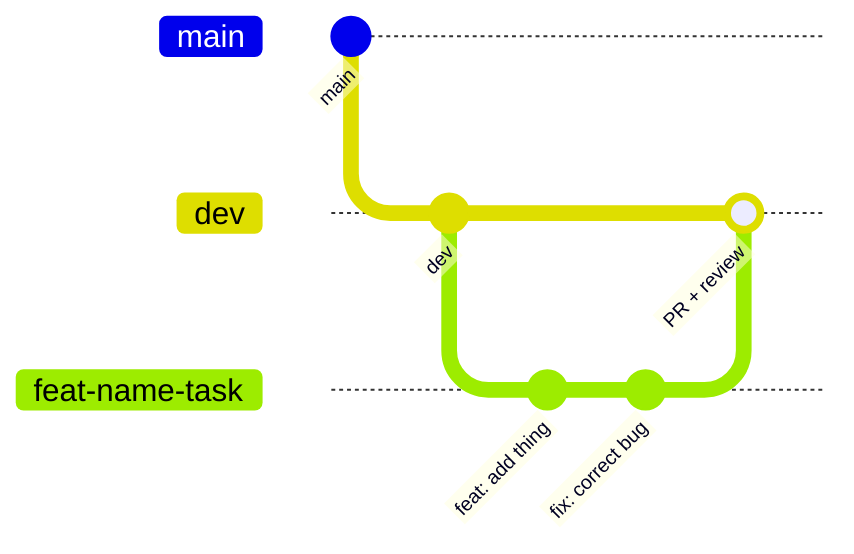

# Team workflow

The team worked with the **Agile** method, using the **Scrum** framework with **1-week sprints**.

## Why Agile

A 5-person team, a fixed deadline and a project that grows feature by feature (accounts, chat, game, stats...) cannot be fully planned on day one. Agile means:

- **Small steps:** the work is cut into small cards, each one finished and checked before the next one.
- **Always a working app:** every sprint ends with something that runs (`make` starts everything), not with half-done pieces.
- **Frequent feedback:** a review and a retrospective every week, so a wrong direction costs one week, not the whole project.
- **Change is normal:** the backlog is re-ordered at each planning when priorities change.

The code shows this way of working: the databases were not designed once and frozen, they grew through successive Prisma migrations (accounts first, then OAuth and 2FA, blocked users, achievements, eaten-ghost and fruit counters...). The split into microservices with shared types (`shared/types`) also lets several people work on different parts of the app in parallel, without blocking each other.

## Roles

Scrum has three roles (Product Owner, Scrum Master, Developers). The team mapped them like this:

| Login | Role(s) | Responsibilities |
|---|---|---|
| `hfegrach` | Product Owner, Developer | Owns the backlog and its priorities, decides what is "done" for a feature; auth |
| `machaouk` | Tech Lead, Developer | Technical decisions, microservices and gateway architecture, code quality |
| `nel-khad` | Project Manager, Developer | Task tracking, keeps the board and the sprint up to date; UI/UX and design system |
| `ynadime` | Developer | Game backend and remote multiplayer |
| `oelmanso` | Developer | Settings and friends |

Everyone is also a **Developer** (the whole team builds, tests and reviews), and everyone gives opinions during planning and retrospectives.

## The sprint cycle




## Artifacts (Trello board)

| Artifact | Where | Content |
|---|---|---|
| **Product backlog** | Trello, backlog list | Every feature needed (the modules of the subject), ordered by priority by the Product Owner |
| **Sprint backlog** | Trello, sprint list | The cards committed for the current week, with an owner for each |
| **Increment** | The `dev` branch | The app with all the cards merged so far; it must always build and start |

A card follows a simple path: **Backlog → Sprint → In progress → In review (Pull Request open) → Done**. A card is small enough to be finished inside one sprint; if it is not, it is split. The Project Manager keeps the board in sync with reality, so anyone can see who is working on what.

Design work (Figma) is done ahead of the code: the UI/UX owner prepares the screens and the design system first, so the developers can build the pages with ready components.

## Definition of Done

A card is **Done** only when all of this is true:

- The feature works in the running app (started with `make`), on desktop and on mobile for UI cards.
- The change went through a **Pull Request** into `dev`, was reviewed and **approved by 1 teammate**, and has **no merge conflicts**.
- The automatic CodeRabbit review (enabled on PRs to `dev`) was read and its relevant remarks were handled.
- Texts are translated (EN / FR / AR) when the feature shows text to the user.
- The Product Owner accepted it during the sprint review.

## Contribution rules (Git)

- No direct push to `main` or `dev`. Every change goes through a Pull Request with **1 teammate approval** and no merge conflicts.
- `main` is the stable branch, `dev` is where finished cards are integrated.
- Branch from `dev`: `feat/<name>-<description>`, `fix/<name>-<description>`, `test/<name>-<description>`.
- Conventional Commits: `feat:`, `fix:`, `chore:` + a present-tense description.
- One card = one branch = one Pull Request, so reviews stay small and fast.



Quick commands:

```bash
git checkout dev && git pull origin dev
git checkout -b feat/<name>-<task>
# code, then:
git commit -m "feat: add <thing>"
git push origin feat/<name>-<task>   # open the PR on GitHub
```

## Tools

| Tool | Used for |
|---|---|
| Trello | Product backlog, sprint board |
| GitHub | Code, Pull Requests, reviews, protected `main` and `dev`, CodeRabbit review |
| Figma | UI/UX design before the code |
| Discord | Daily sync, quick questions, review requests |