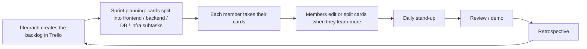
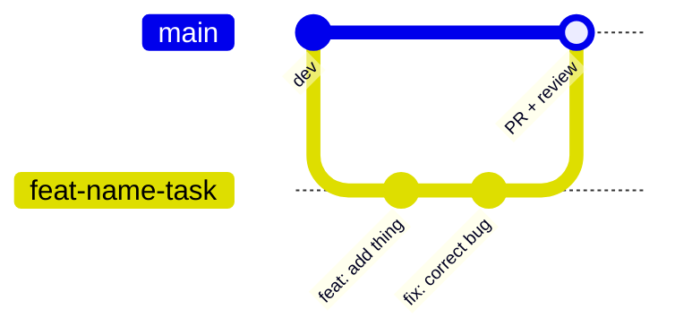

# Team workflow

## Roles

| Login | Role(s) | Responsibilities |
|---|---|---|
| `hfegrach` | Product Owner, Project Manager, Developer | Owns the backlog, plans sprints, leads meetings |
| `machaouk` | Project Manager, Tech Lead / Architect, Developer | Microservices and gateway architecture, task planning |
| `nel-khad` | Project Manager, Developer | UI/UX and design system, task planning |
| `ynadime` | Developer | Game backend and remote multiplayer |
| `oelmanso` | Developer | Settings and friends |

## Task planning



## Scrum ceremonies (1-week sprints)

| Ceremony | When | Rule |
|---|---|---|
| Sprint planning | Sunday, 30 min | Review top backlog cards, split, assign. No coding until tasks are clear |
| Daily stand-up | Every morning, 10 min | What I did, what I do today, blockers. No debugging; blocked members stay for a private session |
| Sprint review and demo | Saturday, 15 min | Live demo with `docker compose up`. Unfinished or untested work stays in the backlog |
| Retrospective | Saturday, 15 min | Blameless Start / Stop / Continue |

Meetings are scheduled and announced on Discord; `hfegrach` leads them.

## Git rules

- No direct push to `main` or `dev`; every change goes through a Pull Request with **1 teammate approval** and no merge conflicts.
- Branch from `dev`: `feat/<name>-<description>`, `fix/<name>-<description>`, `test/<name>-<description>`.
- Conventional Commits: `feat:`, `fix:`, `chore:` + present-tense description.



Quick commands:

```bash
git checkout dev && git pull origin dev
git checkout -b feat/<name>-<task>
# code, then:
git commit -m "feat: add <thing>"
git push origin feat/<name>-<task>   # open the PR on GitHub
```