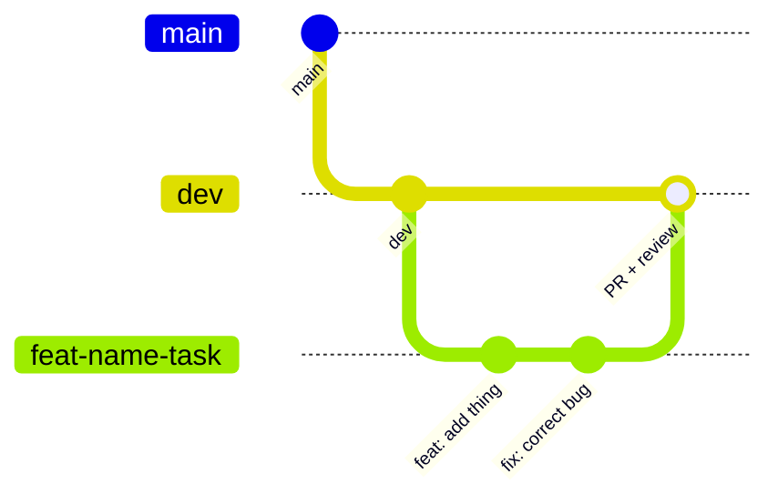

# Team workflow

The team worked with the **Agile** method, in short one-week sprints.

## Roles

| Login | Role(s) | Responsibilities |
|---|---|---|
| `hfegrach` | Product Owner, Developer | Leads meetings |
| `machaouk` | Tech Lead / Architect, Developer | Microservices and gateway architecture|
| `nel-khad` | Project Manager, Developer | UI/UX and design system, task planning |
| `ynadime` | Developer | Game backend and remote multiplayer |
| `oelmanso` | Developer | Settings and friends |

## Contribution

- No direct push to `main` or `dev`. Every change goes through a Pull Request with **1 teammate approval** and no merge conflicts.
- Branch from `dev`: `feat/<name>-<description>`, `fix/<name>-<description>`, `test/<name>-<description>`.
- Conventional Commits: `feat:`, `fix:`, `chore:` + a present-tense description.



Quick commands:

```bash
git checkout dev && git pull origin dev
git checkout -b feat/<name>-<task>
# code, then:
git commit -m "feat: add <thing>"
git push origin feat/<name>-<task>   # open the PR on GitHub
```