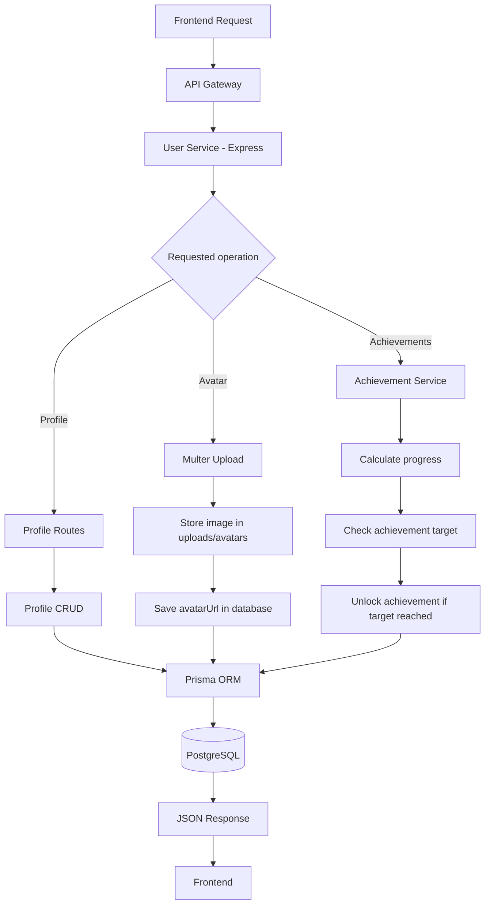
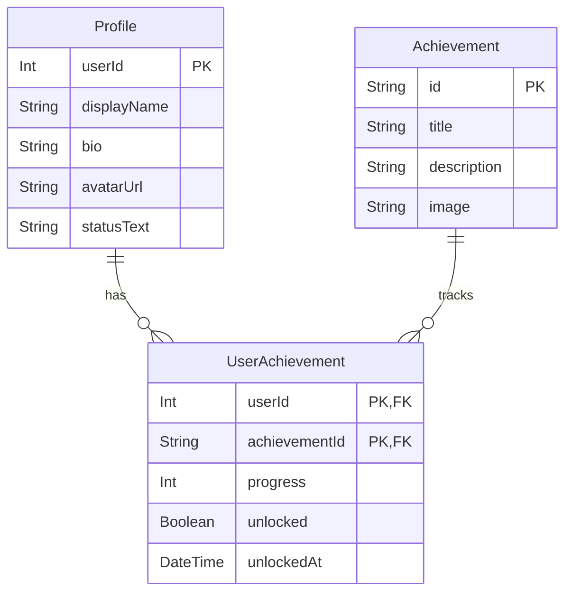

# User Service

## 1. Overview

The User Service manages player profiles, avatar uploads, and achievements.

**Tech stack:** Node.js · Express · TypeScript · Prisma · PostgreSQL · Multer

## 2. User Service Workflow



## 3. Database Structure



**Relationship:** Each player can have multiple achievements. `UserAchievement` stores individual progress and unlock status.

## 4. Main Features & Calculations

| Feature | Logic | Responsible file |
|---|---|---|
| GET | `/profile/me` | Own profile, **with achievements** |
| GET | `/profile/:id` | Another player's profile (no achievements) |
| GET | `/profile/profiles?ids=1,4,7` | Several profiles at once (max 100 ids), used by friends list, chat and leaderboard |
| PATCH | `/profile/me` | Edit `username` (3–20 chars, must be unique), `bio`, `avatar` |
| POST | `/profile/avatar` | Upload avatar (multipart, field `avatar`) |
| POST | `/achievements/update-stats` | Called by the game service after a match (see below); the player is read from the `x-user-id` header |
| GET | `/uploads/avatars/<file>` | Avatar files, served through NGINX `/uploads/` (no JWT) |

### Achievement calculation

```typescript
newProgress = Math.min(target, currentProgress + increment);

unlocked = newProgress >= target;
```

| Achievement | Target | Progress source |
|---|---:|---|
| Champion | 1 | Each win |
| Ghost Hunter | 10 | Ghosts eaten |
| Cherry Collector | 20 | Fruits eaten |
| Pac-Maniac | 1 | Each online match |

## 5. Player Statistics & Progression

*These calculations are displayed on the profile page but are implemented in the frontend and Game Service, not in the User Service.*

| Feature | Calculation / logic | Responsible file |
|---|---|---|
| Win rate | `(wins / matchesPlayed) × 100` | Game Service → stats endpoint |
| Player level | `floor(XP / 500) + 1` | `pages/user/profile.tsx` → `calculateLevel()` |
| XP | `wins × 50 + losses × 10` | `pages/user/profile.tsx` → `calculateLevel()` |
| Current XP | `XP % 500` | `pages/user/profile.tsx` → `calculateLevel()` |
| Current rank | Position in leaderboard | `services/leaderboardService.ts` + `CurrentRank.tsx` |
| Rank badge | Based on leaderboard percentile | `components/profile/CurrentRank.tsx` |

Progress is capped at a target set in `achievement.service.ts` (`ACHIEVEMENT_TARGETS`). Currently `champion` has a target of **1**, and the other three have a target of **x**, so `champion` unlock after the first win in online match. The texts shown to the player come from the translations (`i18n.ts`); the `description` stored in the database is only a placeholder (`--`).

| Method | Endpoint | Description |
|---|---|---|
| GET | `/profile/me` | Get own profile and achievements |
| GET | `/profile/:id` | Get public player profile |
| GET | `/profile/profiles?ids=1,4,7` | Get multiple profiles |
| PATCH | `/profile/me` | Update own profile |
| POST | `/profile/avatar` | Upload profile picture |
| POST | `/achievements/update-stats` | Update achievement progress |

**Gateway prefix:** `/api/users`

Example:

`GET /api/users/profile/me`

## 7. Project Structure

```text
user/
├── prisma/
│   ├── schema.prisma
│   └── seed.ts
│
└── src/
    ├── routes/
    │   ├── profile.routes.ts
    │   └── achievement.routes.ts
    │
    ├── achievement.service.ts
    ├── notify.ts
    ├── prisma.ts
    ├── app.ts
    └── server.ts
```

**Main responsibility:** The User Service centralizes player profile management and achievement tracking, while maintaining persistent data through PostgreSQL and Prisma.