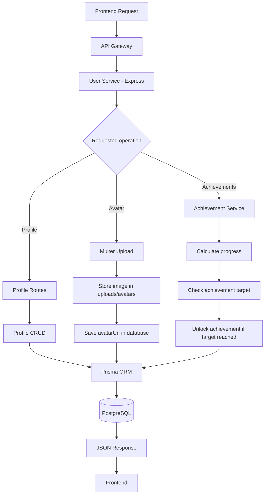
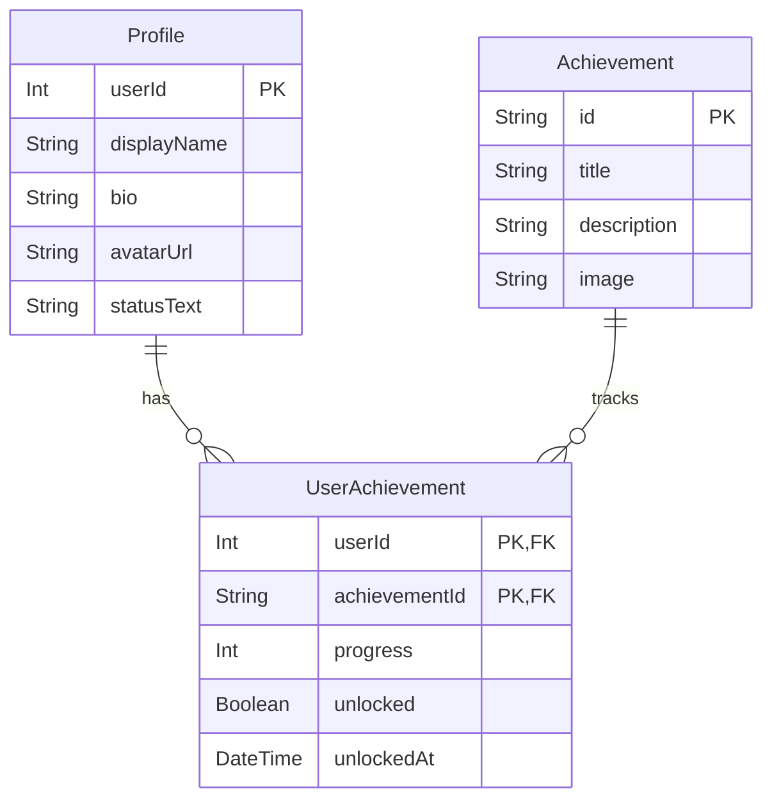

# User Service

## 1. Overview

The User Service manages player profiles, avatar uploads, and achievements.

**Tech stack:** Node.js · Express · TypeScript · Prisma · PostgreSQL · Multer

## 2. User Service Workflow



## 3. Database Structure



**Relationship:** Each player can have multiple achievements. `UserAchievement` stores individual progress and unlock status.

## 4. Main Features & Calculations

| Feature | Logic | Responsible file |
|---|---|---|
| Profile creation | Find existing profile or create a new one | `routes/profile.routes.ts` → `getOrCreateProfile()` |
| Profile update | Validate and update username, bio and avatar | `routes/profile.routes.ts` |
| Avatar upload | Validate image, generate filename and store it | `routes/profile.routes.ts` → Multer |
| Achievement progress | Add match statistics to existing progress | `achievement.service.ts` → `updateUserAchievements()` |
| Achievement unlock | `newProgress >= target` | `achievement.service.ts` |
| Achievement initialization | Create all achievements as locked with zero progress | `routes/profile.routes.ts` → `getOrCreateProfile()` |

### Achievement calculation

```typescript
newProgress = Math.min(target, currentProgress + increment);

unlocked = newProgress >= target;
```

| Achievement | Target | Progress source |
|---|---:|---|
| Champion | 1 | Each win |
| Ghost Hunter | 10 | Ghosts eaten |
| Cherry Collector | 20 | Fruits eaten |
| Pac-Maniac | 1 | Each online match |

## 5. Player Statistics & Progression

*These calculations are displayed on the profile page but are implemented in the frontend and Game Service, not in the User Service.*

| Feature | Calculation / logic | Responsible file |
|---|---|---|
| Win rate | `(wins / matchesPlayed) × 100` | Game Service → stats endpoint |
| Player level | `floor(XP / 500) + 1` | `pages/user/profile.tsx` → `calculateLevel()` |
| XP | `wins × 50 + losses × 10` | `pages/user/profile.tsx` → `calculateLevel()` |
| Current XP | `XP % 500` | `pages/user/profile.tsx` → `calculateLevel()` |
| Current rank | Position in leaderboard | `services/leaderboardService.ts` + `CurrentRank.tsx` |
| Rank badge | Based on leaderboard percentile | `components/profile/CurrentRank.tsx` |

## 6. API Routes

| Method | Endpoint | Description |
|---|---|---|
| GET | `/profile/me` | Get own profile and achievements |
| GET | `/profile/:id` | Get public player profile |
| GET | `/profile/profiles?ids=1,4,7` | Get multiple profiles |
| PATCH | `/profile/me` | Update own profile |
| POST | `/profile/avatar` | Upload profile picture |
| POST | `/achievements/update-stats` | Update achievement progress |

**Gateway prefix:** `/api/users`

Example:

`GET /api/users/profile/me`

## 7. Project Structure

```text
user/
├── prisma/
│   ├── schema.prisma
│   └── seed.ts
│
└── src/
    ├── routes/
    │   ├── profile.routes.ts
    │   └── achievement.routes.ts
    │
    ├── achievement.service.ts
    ├── notify.ts
    ├── prisma.ts
    ├── app.ts
    └── server.ts
```

**Main responsibility:** The User Service centralizes player profile management and achievement tracking, while maintaining persistent data through PostgreSQL and Prisma.