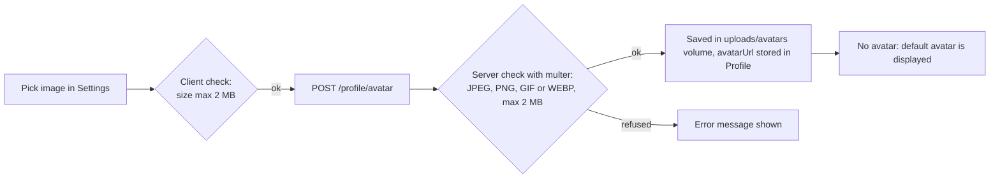
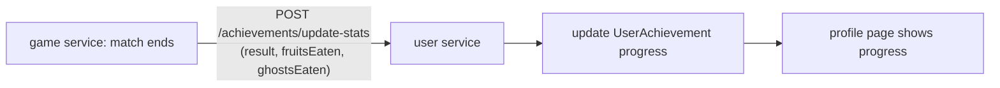

# User service (`user`, port 3004, `user_db`)

**Responsibility:** the public identity of a player — profile, avatar, achievements. Owners: `nel-khad` (profile pages), `oelmanso` (settings).

A profile is **created on first access**: the display name is taken from the auth service, with the default avatar and the status "Ready to play".

## Endpoints (via gateway `/api/users/...`, JWT required)

| Method | Path | Purpose |
|---|---|---|
| GET | `/profile/me` | Own profile, **with achievements** |
| GET | `/profile/:id` | Another player's profile (no achievements) |
| GET | `/profile/profiles?ids=1,4,7` | Several profiles at once (max 100 ids), used by friends list, chat and leaderboard |
| PATCH | `/profile/me` | Edit `username` (3–20 chars, must be unique), `bio`, `avatar` |
| POST | `/profile/avatar` | Upload avatar (multipart, field `avatar`) |
| POST | `/achievements/update-stats` | Called by the game service after a match (see below) |
| GET | `/uploads/avatars/<file>` | Avatar files, served through NGINX `/uploads/` (no JWT) |

A successful `PATCH /profile/me` also creates a `profile_updated` notification (through the chat service).

## Avatar upload

The file extension comes from the checked image type, never from the client's file name.

## Achievements

Four achievements are seeded at start (`prisma/seed.ts`). Each user gets one `UserAchievement` row per achievement (`unlocked`, `progress`, `unlockedAt`), shown on the profile page.

| Achievement | Progress added by each online match |
|---|---|
| `champion` | +1 if the player won |
| `ghost-hunter` | + ghosts eaten |
| `cherry-collector` | + fruits eaten |
| `pac-maniac` | +1 (matches played) |

Progress is capped at a target set in `achievement.service.ts`; the texts shown to the player come from the translations (`i18n.ts`).

Only online matches count: local and bot games never reach the backend.