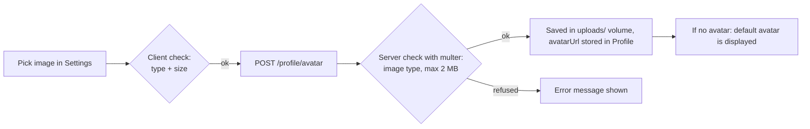
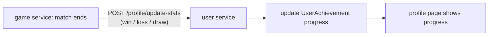

# User service (`user`, port 3004, `user_db`)

**Responsibility:** the public identity of a player — profile, avatar, achievements. Owners: `nel-khad` (profile pages), `oelmanso` (settings).

## Endpoints (via gateway `/api/users/...` or `/api/user/...`)

| Method | Path | Purpose |
|---|---|---|
| GET | `/profile/me` | Own profile |
| GET | `/profile/:id` | Another player's profile |
| GET | `/profile/profiles`, `/profile/batch` | Several profiles at once (used by friends list, chat, leaderboard) |
| PATCH | `/profile/me` | Edit display name, bio, status |
| POST | `/profile/avatar` | Upload avatar (multipart) |
| GET | `/uploads/<file>` | Serve avatar files (NGINX proxies this path) |

## Avatar upload

## Achievements

- Six achievements are seeded (`prisma/seed.ts`): Champion, Ghost Hunter, Cherry Collector, Speedster, Pac-Maniac, Tournament Player.
- Each user has one `UserAchievement` row per achievement with `unlocked`, `progress` and `unlockedAt`; the profile page shows them.

> The game service already sends the result after every match; the receiving route is the part that updates achievement progress.